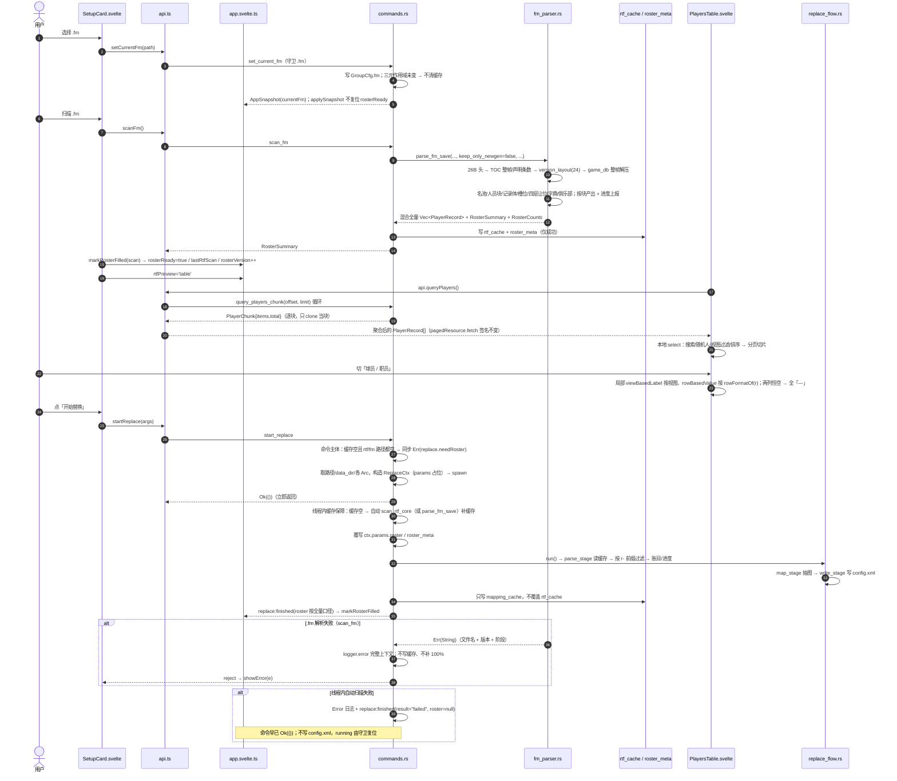
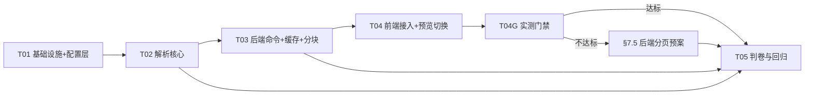

# .fm 存档名单读取 — 实施计划

> 目标：在既有「选择 RTF → 读取球员/职员数据」之外，增加「选择 .fm 存档 → 读取球员/职员数据」，结果格式与 RTF 一致。
> 状态：**待实施**。本文件是完整实施口径；§7.4 实测门禁通过前不进入 T05，实施需另行确认。
> 参考实现：`D:/MyProject/REA-NG_Regens_Manager`（FM 存档逆向资料库，含 4 份逆向文档、`_analysis/scripts/` 脚本族、3 个 `.fm` 与配套 RTF/全量核验报告）。它是资料库，不是可复用源码。

---

## 0. 结论

`rtf_cache` 是**唯一名单数据源**：`scan_rtf` / `scan_fm` 各自把解析结果整体写入缓存；`start_replace` 不按来源分派解析器，只读缓存。缓存为空时由后台线程自动执行一次扫描补齐，再继续替换。

- **Q0 消失**：`parse_stage` 不再 `detect_format`、不再 `parse_roster_progress`，`replace_flow.rs` 全文无 `RtfScanner` 调用、无扩展名分派。
- 「当前生效哪份」不是配置判据，而是 **`rtf_cache` 最近一次被哪次扫描写入的内容**（内存态）。未点「扫描 .fm」时缓存是 RTF 扫描结果；点过才是 .fm 混合名单。
- 名单格式层零变更：`types.ts:8-28,50-59`、`rtf_scanner.rs:136-146,200-293` 一字不动；`.fm` 摘要 `formatCode='extPlayer'`。
- 配置层变更单独登记，不与名单格式层混谈。
- **分块方案不是终局**：先按 §7.4 实测真实用时，再决定是否启用后端分页预案（§7.5）。

**结果同构的边界**：只能做到结构同构，不能做到数值逐格相同。汉字名（存档只有拉丁转写）、R.C.A、所在地、偏好工作、发色显示码取不到，按既定 record 结构留空。

---

## 1. 决策口径总表

### 1.1 已锁定口径

| # | 口径 | # | 口径 |
|---|---|---|---|
| L1 | .fm 名单进入替换链路，与 RTF 对等 | L8 | 取不到的字段该列留空，禁猜填、禁丢行 |
| L2 | .fm 路径并列持久化到用户资料文件 | L9 | 路线 A：Rust 单文件 + zstd + 2 张内置字典 |
| L3 | .fm 扫描结果直接替换 `rtf_cache` | L10 | 名单格式层零变更，`formatCode='extPlayer'` |
| L4 | `start_replace` 统一读缓存，不重解析 | L11 | 错误三要素（文件名 + 版本 + 阶段）+ 完整日志 |
| L5 | RTF 优先 = 最近一次扫描写入的缓存内容 | L12 | 仅 FM24、失败不写缓存、3 档判卷、测试宁少勿多 |
| L6 | 球员+职员混合全量入同一份缓存 | L13 | 硬约束（不新建前端文件、命令登记、三字典同键、注释三禁止等） |
| L7 | 名单预览加球员/职员切换按钮 | L14 | Q7 判定列复用 `kind` 派生，不物理新增列（已确认） |
| L15 | Q4 先实测真实用时，再决定是否后端分页；后端页大小可放到几万行 | L16 | 实测门禁是 T05 的硬前置（§7.4） |

### 1.2 裁决与落地口径

| 题 | 裁决 | 落地口径 | 其他选项的致命缺点 |
|---|---|---|---|
| **A** 缓存为空 | 自动执行扫描 RTF，读出缓存后继续 | 缓存空 → 后台线程内按当前名单路径自动扫描（RTF 优先；无 RTF 且有 .fm 则扫 .fm）→ 写 `rtf_cache` + `roster_meta` → 照常读缓存。两条路径都空在**命令主体**同步 `Err`（§3.2）。`replaceReady` 不加 `rosterReady` 门控 | 回退重解析＝Q0 复活并违背 L4；按空名单继续＝静默写空 config.xml |
| **B** 是否回写缓存 | 不写 | 删 `commands.rs:705`，保留 `:706` 的 `mapping_cache` 写回；`replace:finished` 摘要按全量缓存计算 | 写回过滤子集＝二次替换 `filter_newgen=false` 也恢复不了全量；写回全量＝与「不写」行为相同却多一次 20 万行 clone |
| **E** 改 .fm 路径 | 不清缓存 | `cache_scope` 保持三元 `(prf, group, rtf)`（`commands.rs:79-81`）不动；FM 行状态点显示「已扫描 N 条（来自 xxx.fm）/ 已选 .fm（未扫描）」 | 纳入四元＝改路径也清缓存，与「只有扫描才换缓存」相悖 |
| **F-1** 切换按钮可用性 | 按缓存内容派生，两类都有才渲染 | `hasPlayer`/`hasStaff` 由 `paged.result` 派生；RTF 单格式名单自动隐藏，.fm 混合名单显示 | 始终显示＝RTF 名单点到空类看到空表；按 `formatCode` 隐藏＝.fm 混合名单也是 `extPlayer`，无法区分 |
| **F-2** 按钮位置 | `PlayersTable.svelte` 工具条 | 紧挨随机人筛选（`:215-225`），复用 `.newgan-filter` 结构 | 放 `RosterSnapshotTabs.svelte`＝跨 Tab 泄漏状态、存档台/替换台两处都要改 |
| **Q1** 版本 | 仅 FM24，预留新版本孔位 | `fm_parser.rs` 内单点 `version_layout(major)` + 版本相关常量集中；FM26 分支只返回 Err | 静态推断 FM26＝无真值判卷、静默错名单；全接受＝未知版本崩 |
| **Q4** 人数上限 | 不设上限，分块执行；**先实测再决定是否后端分页** | 解析按人员块分批产出并上报进度；IPC 分块传输，块大小实测三档择优（默认 32768，几万行级）；`api.queryPlayers()` 内部循环聚合，分页骨架零改。实测门禁与后端分页预案见 §7.4 / §7.5 | 一次返回 20 万行＝单次 60 MB JSON 长任务卡顿 UI；不经实测就上后端分页＝共用骨架与快照预览连带改造，可能白做 |
| **Q7** 判定列 | **已确认**：复用 `PlayerRecord.kind` 派生，不物理新增列 | `rowFormatOf(r)` 行级派生，不渲染成表格列；表头按视图、取值按行（详见 §8） | 物理新增一列＝破坏 L10「结果格式与 RTF 一致」、改 Rust/TS 结构、11 个构造点与单测全动（已否决，不再讨论） |
| **Q10** 无记录体 `person` 行 | 跳过，记录日志 | 不产出记录；`RosterCounts.dropped` 计数 + WARN 日志（含数量与占比） | 默认 `PlayerMale` ≈6% 系统性污染提示词；启发式未验证（仅 94.43% in-sample） |
| **Q3** 取不到字段 | 留空保留行 | L8 已锁定；主国籍归一失败写 `""` 保留行 + 单列 WARN 计数 | 丢行＝人数对不上；猜填＝已证伪、污染 config.xml |

### 1.3 Q7 判定列口径（已确认）

`PlayerRecord.kind`（`types.ts:20`、`rtf_scanner.rs:290`）是**不渲染成表格列的行级判定字段**，四值 `playerMale|playerFemale|staffMale|staffFemale`，足以区分 `extPlayer`/`extStaff`。本计划复用它派生 `rowFormatOf(r)`，不新增物理字段。

- 被否决备选（物理新增一列）需改动：`rtf_scanner.rs:260-293`、`types.ts:8-28`、`fm_parser.rs` 组装、`app.svelte.ts` 的 `basedValue`、`PlayersTable.svelte`、`SourcePlayerCard.svelte`、`QueueDock.svelte`、`PlayerViewer.svelte`、`app.store.based.test.ts`。致命缺点：与 RTF 结果不再同构。
- 判定列的实际可观察效果：L8 决定 `based`/`preferredJob` 两列恒空，第 15 列内容仍全为「—」，判定列只影响表头语义与后续补字段时的取值正确性。若要求职员行显示偏好工作**内容**，必须放开 L8，二者只能选一。

---

## 2. 解析路线选型

| 路线 | 落地形态 | 致命缺点 | 判定 |
|---|---|---|---|
| **A 纯 Rust 单文件重写** | `fm_parser.rs`（预估 1000–1300 行）+ `zstd 0.13` + 2 张 `include_str!` 字典，进程内直出 `Vec<PlayerRecord>` | 717 行启发式（`fmexport.mjs:1-717`）是观测判据而非格式规范，抄错任一偏移会静默产出错误名单，编译期无保护，只能靠 3 档真实存档逐列判卷兜底；`zstd-sys` 需 C 编译链（`cc` 已在 `Cargo.lock:437`） | **推荐**：仅 1 个编译期 crate，无运行时进程/端口/临时文件 |
| B Node 脚本 sidecar | 打包 `_analysis/scripts/` 起 node 进程 | 用户机器无 Node；`zlib.zstdDecompressSync` 需 Node ≥ 22.15；脚本 `../../out/` 相对路径脱离仓库即失效；stdin/stdout 管线本机 CreatePipe 已实锤失败 | 否决 |
| C 先跑脚本出 CSV/JSONL | 用户预跑 `run-all.mjs:85-112`（26–28.7 s/档） | 把「免导出」退化成命令行预跑；JSONL 26 列不是 `PlayerRecord`，映射工作与 A 重叠 | 否决，仅作离线判卷 |
| D 外部 `fmsave` | Python 进程桥 | `_analysis/docs/EXTERNAL_REPOS.md:25,34-84` 结论：可进产品仅 3 条且只覆盖 FM26；本机只有 FM24 真值 | 否决 |

A 规避 B/C/D：全部解析在 Tauri 进程内完成，无外部进程、无中间文件、无运行时依赖。

**单文件论证**：参考流水线共享单个 `buf` 与 6 张中间索引（`fmexport.mjs:73-137`），拆分需跨模块暴露 `&[u8]` 生命周期，等于新抽象层；386 MB 缓冲不可 clone；项目既有大单模块风格（`rtf_scanner.rs` 1773 行 / `commands.rs` 2691 行）。

---

## 3. 缓存唯一数据源

### 3.1 写入侧

| 入口 | 行为 |
|---|---|
| `scan_rtf`（`commands.rs:511-538`，解析主体零改） | 末尾 `summary.clone()` 写 `AppState.roster_meta`（`RosterSummary` 已 `Clone`，`rtf_scanner.rs:200`） |
| `scan_fm`（新增） | 全量混合名单写 `rtf_cache`，同时 `summary.clone()` 写 `roster_meta` |
| `set_current_rtf` | 写 RTF 路径；`cache_scope` 含 `rtf`，比对变化会清 `rtf_cache` + `mapping_cache` + `roster_meta`（`commands.rs:304-313`） |
| `set_current_fm` | 写 .fm 路径；`cache_scope` 三元不含 `fm`，比对相等 → **不清缓存**（E 裁决）。仍需按 `:306-311` 同款调 `clear_caches_if_scope_changed`，是第 8 个调用点 |
| `clear_caches_if_scope_changed`（`commands.rs:85-93`） | 三元作用域变化时清 `rtf_cache` + `mapping_cache`，并把 `roster_meta` 置 `None`；7 个既有调用点主体不动 |
| 替换成功 | **不写** `rtf_cache`；只写 `mapping_cache`（B 裁决） |

`AppState.roster_meta: Arc<Mutex<Option<RosterSummary>>>` 随缓存同生共死。缺了它，读缓存后 `format` / `format_code` / `language` 只能硬编码，`app.svelte.ts:74-86,298-305` 的第 15 列表头会在替换后跳变，`app.store.based.test.ts:23-46` 锁死的口径全破。

### 3.2 读取侧与 A 裁决的结构影响

`start_replace` 是同步命令 `pub fn`（`commands.rs:844`），`Ok(())` 在 `:910` 立即返回，流水线在 `std::thread::spawn`（`:902`）内跑。**线程内发生的错误不能再作为命令 `Err` 回传**，只能经 `replace:finished`（`:749`）与 Error 日志。因此错误分两层：

**命令主体（同步、可返回 `Err` 弹窗）**：

1. 廉价取值：`rtf_path`、`fm_path`、`img_dir`、`snapshot_path`、`data_dir`、`AppState` 各 `Arc` 句柄。
2. 前置校验：`rtf_cache` 为空 **且** `rtf_path` 与 `fm_path` 都为空 → `Err(t.replace.needRoster)`，不启动线程、不写 config.xml。这是 §11 时序图与 R8 唯一适用 `Err` 的分支。
3. 其余参数校验沿用 `:861-871`（组、模式、规则配置）。

**`ReplaceCtx` 结构体（`commands.rs:617-629`）新增 4 个字段**：`data_dir: PathBuf`、`rtf_path: String`、`fm_path: String`、`roster_meta: Arc<Mutex<Option<RosterSummary>>>`。`params: ReplaceParams` 字段**保留**（`body()` `:645-670` 直接消费 `self.params.img_dir` / `pre_scan`），命令主体用空 `roster`（`Arc<Vec<PlayerRecord>>` 空表）与 `roster_meta` 兜底值构造占位 `ReplaceParams`，线程内缓存保障完成后覆写 `self.params.roster` 与 `self.params.roster_meta`。这样 `body()` 其余逻辑零改。

**线程内缓存保障（`body()` 开头，`run()` 之前）**：

1. `rtf_cache` 非空 → 跳过扫描，直接取 `roster` 快照 + `roster_meta`。
2. 缓存空且 `rtf_path` 非空 → `nationality::refresh(&data_dir)` → `scan_rtf_core(&rtf_path, nat, ...)`（`commands.rs:455-469`，同文件私有函数，线程内可直接调用）。
3. 缓存空且只有 `fm_path` → `nationality::refresh(&data_dir)` → `fm_parser::parse_fm_save(...)`（需 `pub(crate)`）。
4. 扫描成功 → 写 `rtf_cache` + `roster_meta` → 重新取 `roster` 快照 → 覆写 `self.params.roster` / `self.params.roster_meta`。
5. 扫描失败 → 记 Error 日志，发 `replace:finished`（`result: "failed"`、`roster: null`），`running` 由 `RunningGuard` 复位，**不写 config.xml**。RTF 路径沿用既有「RTF 格式不合法」文案并在日志标注「自动扫描」；.fm 路径走 §9 三要素。

**`roster_meta` 的 `Option` 兜底**：`ReplaceParams.roster_meta: RosterSummary` 非 Option。取用时若为 `None`（理论上是缓存非空但摘要缺失的异常态）→ 记 WARN 并用 `RosterSummary` 的字段兜底（`format="FM 存档名单"、`format_code=ExtPlayer`、`language="English"`、`total=roster.len()`、`newgan` 按 `r-` 前缀计数、`detailed=roster.iter().any(|r| r.detailed.is_some())`），不硬编码单一值、不中断流程。该兜底只在异常态出现，单测必须覆盖。

**自动扫描的进度通道**：`scan_rtf_core` / `parse_fm_save` 的回调是 `FnMut(usize, usize)`，替换流水线用 `ProgressFn`（带 status/百分比）。缓存保障期间用适配器把 `(done,total)` 映射到 `replace:progress` 的 0→10 段（`STAGE_RTF`），并在 `parse_stage` 之前收口到 10%，避免与 `parse_stage` 的 0→10 段重叠导致进度回退（`R10`）。若无需暴露细粒度，可只上报「正在自动扫描名单…」一次并直接跳到 10%。

**`ReplaceParams`（`replace_flow.rs:67-93`）**：+`roster: Arc<Vec<PlayerRecord>>`、+`roster_meta: RosterSummary`，删 `rtf_path`、`nationality`。自动扫描所需的路径、data_dir、国籍表只存在于 `ReplaceCtx` 与线程局部变量，不进 `ReplaceParams`，不引入来源分派参数。

**前端就绪口径**：`replaceReady`（`app.svelte.ts:58-61`）与 `missingPrerequisites`（`:64-70`）改为「RTF 或 .fm 任一已选」即就绪；两者都空时显示新键 `replace.needRoster`（「设置名单文件」），既有 `t.replace.needRtf`（"设置 RTF 名单"）保留但不再用于该条件。缓存会自动补齐，不需要 `rosterReady` 门控。

### 3.3 Q0 消失的静态判据

`replace_flow.rs` 全文不得出现 `RtfScanner`、`detect_format`、`parse_roster_progress`、`rtf_path`、扩展名判断。`parse_stage`（`:293-350`）只做：读缓存 → `filter_newgen` 过滤 → 账目/进度 → 交给 `map_stage`。这条作为单测中的静态断言。

---

## 4. 数据结构与接口

### 4.1 配置层（单独登记）

| 项 | 位置 | 口径 |
|---|---|---|
| `GroupCfg` | `profile_manager.rs:21-24` | `{ #[serde(default)] rtf: String, #[serde(default)] fm: String }`，无第三字段、无枚举 |
| 落盘 | `prf_path()`(`:166-173`)、`persist_prf()`(`:659-673`) | `data/.user/<档名>/<档名>.json`；实测 `wer.json` 3 组只有 `"rtf"` 键，缺键补 `fm=""` |
| 迁移 | `:224-236` | 仅 `:230` 的 `GroupCfg { rtf }` → `GroupCfg { rtf, ..Default::default() }` |
| `AppSnapshot` | `commands.rs:188-197` | +`current_fm: String`（`currentFm`），构造点 `:215`、`:354` |
| `GroupInfo` | `commands.rs:172-176` | +`fm: String`，构造点 `:222`、`:360` |
| `types.ts` | `:33-34,64-69` | 同步上述两处 + `PlayerChunk`；`:8-28,50-59` 名单格式层零改 |
| `AppState.roster_meta` | `commands.rs:42-55`、`lib.rs:304-317` | `Arc<Mutex<Option<RosterSummary>>>` |

### 4.2 Tauri 命令（3 条新增，全部登记 `lib.rs:325`）

| 命令 | 签名 | 说明 |
|---|---|---|
| `set_current_fm` | `(state, path: String) -> Result<AppSnapshot, String>` | 镜像 `set_current_rtf`（`:304-313`）；守卫 `.fm` 扩展名，**只拒绝不参与分派**；调 `clear_caches_if_scope_changed`，三元不含 fm → 不清缓存 |
| `scan_fm` | `async (app, state) -> Result<RosterSummary, String>` | 镜像 `scan_rtf` 外壳：`get_cur_fm()`、守卫、`nationality::refresh`(`:518`)、`TaskProgress::new`(`:520`)、成功才写缓存 + `roster_meta`(`:523`)、`logger.info`(`:524-535`)、`progress.finish()`(`:536`)。`parse_fm_save` 是 CPU 密集（数十秒），沿用 `scan_rtf` 的 async 命令外壳；若实测阻塞界面，再改为 `tauri::async_runtime::spawn_blocking`（见 §7.4 实测项 M0） |
| `query_players_chunk` | `(state, offset: usize, limit: usize) -> Result<PlayerChunk, String>` | Q4 分块传输，见 §7 |

`PlayerChunk` 为 `#[derive(Serialize)] #[serde(rename_all = "camelCase")]` 的 `{ items: Vec<PlayerRecord>, total: usize }`；前端在 `types.ts` 增 `export interface PlayerChunk { items: PlayerRecord[]; total: number; }`。后端边界：`limit` 夹到 `1..=65536`，`offset >= total` 返回空 `items` 且 `total` 不变。

**`query_players`（`:1281-1283`）保留原样但前端不再调用**：它作为回归基准（比对缓存条数、验证分块聚合完整性）与后端单测入口存在，不删除、不改造。`query_players_by_uids`（`:1289-1292`）零改。

### 4.3 `parse_stage` 重写

```rust
// replace_flow.rs:293-298 —— 签名不变，函数体重写
fn parse_stage(
    params: &ReplaceParams,
    progress: ProgressFn,
    cancel: &AtomicBool,
    logger: &impl LogSink,
) -> Result<(Vec<PlayerRecord>, RosterSummary, RosterCounts), RunResult>
```

1. `progress("读取名单缓存…", STAGE_RTF.0, 0, 0)`（`STAGE_RTF=(0,10)`，`:40` 不变）。
2. `let full = params.roster.as_ref();`，空 → `Err(failed("名单缓存为空"))`（与线程内缓存保障双保险；属内部守卫，不走 .fm 三要素）。
3. `filter_newgen` → `full.iter().filter(|p| p.uid.starts_with(NEWGAN_UID_PREFIX))`，判据与 `rtf_scanner.rs:58,519-521` 同源。
4. 进度按 4096 条折算 `item(..., STAGE_RTF, i, full.len())`；每 4096 条查一次 `cancel`（对齐 `rtf_scanner.rs:504-512`）。
5. **替换阶段账目**（与 §5 的扫描阶段账目是两份独立 `RosterCounts`，字段同名但语义不同，禁止互相套用）：`{ rows: full.len(), kept: filtered.len(), filtered: full.len()-filtered.len(), dropped: 0, stray: 0 }`；`logger` 用于 `counts.log_tail()` 与「读取缓存耗时」日志。
6. `RosterSummary` 从 `params.roster_meta.clone()` 覆写 `total`/`newgan`/`detailed`，保证与 `query_players` 条数一致。

11 个 `ReplaceParams` 构造点全改：`commands.rs:875`（命令主体占位构造）+ `replace_flow.rs:615,682,736,811,871,906,928,985,1049,1107`（10 处测试，模块起点 `:575`）。测试新增 `test_roster(path, nat)` 辅助函数，用 `RtfScanner::parse_roster`（`rtf_scanner.rs:438-453`，`#[cfg(test)]`）预解析夹具；`custom_nationality_table_drives_replace`（`:663-700`）改为「自定义表预解析 → 填 `params.roster` → `run()`」。**断言不砍、用例不减。**

---

## 5. 字段口径（L8 留空规则落地）

记号：`R`=人员块 birth 偏移，`i`=人员槽位偏移，`b`=球员记录体，`p`=职员记录体，`j=u8@p−6`（`子文档A §4.4:388-412`）。数值写十进制字符串。**兜底一律该列留空、保留行，禁猜填、禁丢行。**

| 字段 | .fm 取值 | 写入值 | 兜底 / 禁止事项 |
|---|---|---|---|
| `uid` | `u32@i` | `u8@i−12>=8` → `"r-"+uid`，否则 `uid` | 禁止 `uid>999999` 下界（`子文档A §4.1:278-282`）；定位失败不产生记录 |
| `primary_nat` | `rank=u8@R+9`；归化 3 条件成立取新国籍 ref（`fmexport.mjs:405-407`） | `rank2id`(238 对) → nation id → `code` → `NationalityTable` 归一三字码 | 名次不在键集合（14 空洞 `主文档 §3.2:211`）→ `""` 保留行 + 单列 WARN 计数；异码 ESW→SWZ 等 19 个走 `nat.resolve`；禁止猜填/丢行 |
| `sec_nat` | 关系区首条 `kind=8 && flag=0x09` 的 `ref`（`fmexport.mjs:704-716`） | 同上三字码 | 无条目 → `""`（唯一允许可空的国籍列）；`flag=0x0E` 排除 |
| `name` | 三段名池 `A=u32@cur`、`B=u32@cur+5`、`C=u32@cur+10`，`0xFFFFFFFF` 哨兵 | `given && surname ? "{given} {surname}" : (given\|surname\|common\|"")` | 仅拉丁转写，不回填/不音译；无名字 → `""` 保留行 |
| `hair_length` | `u8@R+7` | 数字串 | 值域 `0..5`（`rtf_scanner.rs:86`），越界 → `""` |
| `hair_color` | `u8@R+6` raw | 判定式：`status==0xFF && raw∈{6,17,18}` → `eth==0 ? 3 : (eth∈{1,7} ? 5 : raw)`；否则原值（`fmexport.mjs:355-363`） | 值域 `1..19`（`rtf_scanner.rs:87`），越界 → `""`；调色板未闭合时提示词走随机兜底（`prompt.rs:225-237`） |
| `ethnicity_code` | `u8@R+5` | 数字串 | 值域 `0..10`（`rtf_scanner.rs:84`），越界 → `""` |
| `kind` | 角色族（有 `b`→球员 / 有 `p`→职员）+ 性别位 `u8@i−11 & 0x10`（`主文档 §3.8:329-354`，397,086 人 0 错） | `person_kind(...)` → 四值（`rtf_scanner.rs:186-194`） | 必须与 `detailed.gender` 一致；无记录体 `person` 行跳过并记 WARN（Q10） |
| `detailed` | — | 恒 `Some(DetailedInfo{..})` | 给 `None` 会判 `detailed=false`（`rtf_scanner.rs:221`）并隐藏 11 列 |
| `skin_code` | `u8@R+8` | `0xFF` → `ETH_SKIN[eth]=[5,7,12,18,14,13,16,2,15,16,8]`（`fmexport.mjs:336`），否则原值 | **禁止直接写 255**（越界 `SKIN_RANGE 0..19`，`rtf_scanner.rs:85,791`）；渲染后仍越界 → `""`。判卷用配套 `.rtf` / `verify.json` 渲染口径，`.md` 里的 255 是分析产物存档原值 |
| `avatar` | 不可得 | **`""` 恒空** | L8 |
| `is_newgan` | `u8@i−12>=8` | `"Yes"` / `"No"` | 只做包含匹配（`rtf_scanner.rs:73-75`） |
| `gender` | `u8@i−11 & 0x10` | `"Female"` / `"Male"` | 与 `kind` 一致；`prompt.rs:109-112` 认 `Female` |
| `age` | 游戏年 `u16@db+38`、游戏日 `u16@db+36 & 0x1FF`（`run-all.mjs:124-128`）；出生 `u16@R & 0x1FF`/`u16@R+2` | `GY - birthYear - (doy2md(GD,leap(GY)) < doy2md(birthDay,leap(birthYear)) ? 1 : 0)`（`主文档 §3.4:249-270`） | 禁止系统日期/手输；禁止朴素 9 位日序直接比（仅 99.67–99.70%）；越界整份 Err |
| `height` | 球员 `u16@b+122`；职员 `u8@p+97+3j`，`0→182`、`<=115→+100` | `"{n} cm"` | 与 `rtf_scanner.rs:1253,1456` 及 `prompt.rs:311` 同口径；不可得 → `""` |
| `club` | 球员 `cid=u24@b+15` → 本档 club 队伍块 → 紧邻两 UTF-8 串 short（`fmexport.mjs:166-296`）；职员按连续 seq 反查（`:297-334`） | 短名 | `cid==0xFFFFFF` → `""`；**禁止附表发行**（跨档 cid 仅 2.44% 同名） |
| `based` | 不可得 | **`""` 恒空** | L8；`prompt.rs:264-276` career 由模板默认值兜底 |
| `preferred_job` | 未定位 | **`""` 恒空** | L8；`prompt.rs:188-193` 跳过 identity 安全 |
| `ca` / `pa` | 球员 `u16@b+0/+2`；职员 `u16@p+2+3j / +4+3j` | 数字串 | 职员 `kind=3` 未解族（`fmexport.mjs:598`，liv 82,450 条）→ `""` |
| `rca` | 存档不存 | **`""` 恒空** | L8；**禁止拿 CA 冒充**（`主文档 §8.8:656`） |
| `extra_fields` | 概念不适用 | **`[]` 恒空数组** | L8（`rtf_scanner.rs:275,936`） |

`RosterSummary`：`total=data.len()`、`newgan=r-` 前缀计数、`detailed=true`、`format="FM 存档名单（球员+职员）"`（展示串可改词，`types.ts:50-52`）、`format_code=RtfFormat::ExtPlayer → 'extPlayer'`、`language="English"`（`rtf_scanner.rs:423`）。**扫描阶段 `RosterCounts`**：`rows`=绑定成功人员块数、`kept=data.len()`、`dropped`=未绑定/校验失败/`person` 跳过数、`filtered=0`、`stray=0`；空国籍行单列 WARN 计数。与 §4.3 的替换阶段账目互不套用。

**禁止往 `based`/`preferred_job` 塞占位符**（`prompt.rs:264-265` 会把任何非空值拼进提示词）。

---

## 6. 版本孔位（Q1）

仅 FM24 生效，预留新版本接入点，但**不实现 FM26**：

```rust
// fm_parser.rs —— 版本相关常量集中在一个结构，流水线只从 layout 取值
struct FmLayout { name_pool: NamePoolLayout, record_offsets: RecordOffsets, dict: &'static str, db_section: &'static str }
fn version_layout(major: u8) -> Result<FmLayout, String> {
    match major { 24 => Ok(FM24_LAYOUT), _ => Err(/* 不支持的版本 */) }
}
```

- 孔位 = **单点 `match` + 版本常量表**。不引入 trait、不拆模块、不预写 FM26 偏移、不做静态推断。
- `read_version`（解 `save_game_summary` 取 major，`子文档A §1.1:13-20`）在进入 `game_db` 之前调用；`major != 24` 立即整份 Err，**不解压 330 MB**。
- 孔位只承诺「常量层可插拔」，不承诺「零改动接入新版本」。若未来版本差异超出换常量（例如名池结构改变），仍需改流水线主体——这是刻意不做的过度设计。
- 字典文件按版本命名（`fm_nation_ranks_24.json` / `fm_nation_ids_24.json`），`assets.rs` 各配一个 `include_str!` 常量；新版本加一份字典 + 一个 `assets.rs` 常量 + 一个 match 分支。

---

## 7. 分块执行、实测门禁与后端分页预案（Q4）

人数不设上限。本方案分**已定部分（§7.1–7.3）**与**条件部分（§7.5）**：先按已定部分实施并实测，再决定是否启用后端分页。

### 7.1 三层分块（已定）

| 层 | 口径 |
|---|---|
| 解析 | `fm_parser` 按人员块分批 extend 结果 `Vec`（预分配容量、分块追加，不一次性构造大临时 Vec）；每 4096 条 `progress.report` 并查 `cancel`；`game_db` 仍全量落单个 `Vec<u8>`（见 §13） |
| IPC | `query_players_chunk(offset, limit) -> Result<PlayerChunk, String>`，后端在锁内对 `rtf_cache` 切片、只 clone 当块。`limit` 是**传输块大小**，与 UI 每页行数无关，默认 **32768**（几万行级），实测在 8192 / 32768 / 65536 三档中择优（§7.4 M1/M2） |
| 渲染 | `pagedResource.svelte.ts` **零改**：`fetch` 签名仍是 `() => Promise<T[]>`，换代令牌防乱序（`#token`，`:46,138-148`）继续生效；分页/搜索/排序/切换仍在前端本地 `select`（`:68-93`）完成 |

后端单块大小可放大到几万行：单次 JSON 体积可控、IPC 往返次数从 20 万行/8192 ≈ 25 次降到 ≈ 10 次，且不需改造共用骨架。块大小是实测参数，不是协议常量。

### 7.2 前端聚合（已定）

`api.queryPlayers()` 内部循环调用 `query_players_chunk`，累加 `items`，逐块校验 `total` 一致。返回值仍是 `Promise<PlayerRecord[]>`，`PlayersTable.svelte:58` 与 `pagedResource` 零改。

- `total` 一致但 `offset` 已覆盖全部 → 返回聚合数组。
- 块间 `total` 变化 → 从头重取**一次**；第二次仍不一致 → 抛错，由 `pagedResource.onError`（`PlayersTable.svelte:94-97`）弹窗并返回 `[]`，不返回残缺数组。
- 换代期间旧 `fetch` 仍会跑完在途块（`#token` 在 `#load()` 拿到最终结果后才比对），这是**已知的 IPC 浪费**，不中断循环；结果被丢弃。若实测该浪费显著，可在 `api.ts` 接受可选 `AbortSignal`，属门禁后的优化项，不在首版范围。

### 7.3 已定方案的边界（如实登记）

20 万行仍全量进入前端内存（约 60 MB）与 Svelte `$state` 代理，只解决「单次大 JSON 解析长任务」，不解决内存占用与代理开销。**是否因此需要后端分页，由 §7.4 实测决定，不由推断决定。**

替换侧：`ReplaceParams.roster` 用 `Arc<Vec<PlayerRecord>>` 传缓存快照，避免 20 万行整表 clone（`commands.rs:699` 注释实测约 0.1 s）。

### 7.4 实测门禁（T04 后、T05 前的硬前置）

**环境**：本机 Windows、dev 版（`pnpm tauri dev`，dev 端口 1420）、非调试器附加；样本用最大档 `ZhanHao Huang-利物浦.fm`（liv，315,140 行）与 `...20261025.fm`（zq25，236,598 行）各测 3 次取中位数；冷启动与热缓存各一轮。

**测量方式**：Rust 侧 `Instant` 打点写日志（解析总耗时、写缓存耗时）；前端 `performance.now()` 打点 + `PerformanceObserver`（`longtask`，WebView2 基于 Chromium 可用）取最长任务；进程内存用任务管理器 RSS 增量。

| 指标 | 定义 | 默认阈值（可调） |
|---|---|---|
| M0 | `scan_fm` 调用期间主线程最长任务（阻塞感知） | < 200 ms；超则 `scan_fm` 改用 `spawn_blocking`（§4.2） |
| M1 | 「扫描完成 → 名单表首屏可交互」（含分块聚合 + `$state` 代理） | < 3000 ms |
| M2 | 单次最长任务（Long Tasks API） | < 200 ms |
| M3 | 搜索框输入（防抖后）→ 表格更新 | < 300 ms |
| M4 | 视图切换 / 点表头排序 → 渲染完成 | < 300 ms |
| M5 | 常驻内存增量（不含 `game_db` 解压峰值） | < 400 MB |

**分块粒度选择**：在 8192 / 32768 / 65536 三档各跑一遍，取 M1 最小且 M2 达标的档作为 `limit` 默认值。

**决策规则**：

| 实测结果 | 决定 |
|---|---|
| M1–M5 全达标 | 保留 §7.1 方案，不启用后端分页；`pagedResource` 系列保持零改 |
| 仅 M1 不达标、M2 达标 | 优先调 `limit` 粒度或分块并发，不上后端分页 |
| M2 / M3 / M4 任一不达标 | 启用 §7.5 后端分页预案 |
| 仅 M5 不达标 | 先评估 `$state.raw` / 浅代理（改 `pagedResource` 一行），仍不达标再启用 §7.5 |

实测结果写入 `docs/` 同目录的简短记录或工作日志，**决策必须有数据，不得跳过门禁直接实施后端分页**。这是 L16。

### 7.5 后端分页预案（仅门禁判定后启用）

**口径**：后端承担搜索 / 随机人筛选 / 视图过滤 / 排序 / 统计，`query_players_page(page, size, search, sortKey, sortDesc, newgan, rosterView)` 返回 `{ items, total }`。**`size` 按几万行设计（默认 32768，范围 8192–65536），不按 UI 每页几十行切**——后端返回的是「大页」，前端在已取得的大页内按 `pagedResource` 的 pane 自适应行数二次切片；翻出当前大页范围才请求下一页。这样 IPC 往返保持在个位数，且前端常驻只有 1–2 个大页。

| 项 | 口径 |
|---|---|
| 后端 | `commands.rs` 新增 `query_players_page`；在锁内对 `rtf_cache` 做筛选/排序/切片，只 clone 命中行；`total` 是筛选后总条数 |
| 前端 | `pagedResource.svelte.ts` 增 `fetchPage(page, size, query)` 模式（与现有 `fetch` 全量模式并存，`SnapshotPreview.svelte` 走全量分支不受影响）；`PlayersTable.svelte` 的 `select` 改为把搜索/筛选/排序/视图状态作为查询参数下推，工具条输入需防抖 |
| `totalPages` | 由「筛选后 total / 面板行数」得出；大页边界与 UI 页边界独立，需两层页码换算 |
| 骨架测试 | `pagedResource.test.ts` 增一条「分页模式」主题用例，断言令牌防乱序与查询参数变化触发重取；断言不砍 |
| 修改面 | 由 16 个文件增至 18–19 个（+ `pagedResource.svelte.ts`、`pagedResource.test.ts`，视改造深度可能 + `SnapshotPreview.svelte`）；§10.3 的「明确不动」对这三个文件在预案启用时解除 |

**致命缺点**：共用分页骨架被两处使用，改造会破坏「分页/筛选/排序全在前端内存」的既有单测语义；搜索/排序下推后每次输入都要防抖 + IPC，弱网/慢机上体感可能反而不如本地过滤；大页内二次切片引入两层页码，边界 bug 难查。**必须先有 §7.4 实测数据支撑才允许启用。**

---

## 8. 名单预览切换与第 15 列（F-1 / F-2 / Q7）

### 8.1 判定列 = `kind` 的行级派生

```ts
// app.svelte.ts —— 共用实现单点
export function personKindGroup(r: PlayerRecord): 'player' | 'staff'   // kind 以 staff 开头 → staff
export function rowFormatOf(r: PlayerRecord): 'extPlayer' | 'extStaff' // 判定列：不显示为表格列
```

`rowFormatOf` 即裁决要求的「不显示的判定列」。它不新增物理字段、不渲染成列，只在需要逐行解释第 15 列时使用。

### 8.2 视图切换

| 项 | 口径 |
|---|---|
| 状态 | `appStore.rosterView: 'all' \| 'player' \| 'staff'`（`app.svelte.ts:16-41`） |
| 过滤 | `PlayersTable.svelte:68-93` 的 `select` 内、`newganQuery` 之后、排序之前：`out.filter(r => personKindGroup(r) === appStore.rosterView)` |
| 页码 | 切换时 `paged.page = 0`；`pagedResource.svelte.ts:114` 已把页码夹到 `last` |
| 复位 | `onReset`（`PlayersTable.svelte:61-67`）加 `rosterView='all'`，对齐 `newganFilter='any'` |
| `rosterVersion` / `rosterReady` | 不 bump、不复位（纯视图过滤，缓存仍在） |
| 按钮位置 | 工具条 `:203-240`，紧挨随机人筛选，复用 `.newgan-filter`；`RosterSnapshotTabs.svelte` 零改 |
| 可用性 | `hasPlayer`/`hasStaff` 由 `paged.result` 派生（`$derived` 缓存 + 早退），两者都真才渲染；RTF 单格式名单自动隐藏 |
| 文案 | 三字典同键同签名新增 `table.rosterViewLabel` / `rosterViewAll` / `rosterViewPlayer` / `rosterViewStaff` / `rosterViewEmpty` / `rosterViewMixedHeader`（全为 string）；字号 `--fs-*`，悬停 `use:tip` + `.tip`，`app.css` 零改。若实测工具条换行挤压，只在 `PlayersTable.svelte` 现有局部 `<style>` 内加一条宽度规则 |

### 8.3 第 15 列语义（Q7 落地）

**全局 getter（零改）**：`isStaffRoster` / `basedLabel` / `basedValue`（`app.svelte.ts:74-86`）及其四个消费点（`PlayersTable.svelte:349,400`、`SourcePlayerCard.svelte:145`、`QueueDock.svelte:180,208-209`、`PlayerViewer.svelte:207`）在 **RTF 名单**下全部零改，`app.store.based.test.ts:23-46` 锁死的三条口径不动。`appStore.basedLabel` 恒按 `lastRtfScan.formatCode` 判定，与 `rosterView` 无关。

**局部派生（仅 .fm 混合名单、仅 `PlayersTable.svelte`）**：新增组件内 `viewBasedLabel`，按 `rosterView` 派生 ——

| `rosterView` | 表头 | 单元格 |
|---|---|---|
| `player` | `t.table.colBased`（所在地） | 局部 `rowBasedValue(r)` 按 `rowFormatOf(r)` 读 `based` |
| `staff` | `t.table.colJob`（偏好工作） | 局部 `rowBasedValue(r)` 按 `rowFormatOf(r)` 读 `preferredJob` |
| `all` | `t.table.rosterViewMixedHeader`（如「所在地 / 偏好工作」，三字典同值） | 同上按行判定 |

- RTF 名单不使用 `viewBasedLabel`，仍走 `appStore.basedLabel` / `basedValue`；切换按钮此时按 F-1 隐藏。
- 由于 L8 令两列恒空，单元格内容仍全为「—」；判定列的可观察效果只有表头语义。
- **硬约束**：不得为让职员视图显示「偏好工作」而改 `isStaffRoster`。致命缺点：`app.store.based.test.ts` 三口径全破、四个消费点漂移、`formatCode` 语义被 UI 视图污染、RTF 单格式名单表头在切换时跳变。
- R12 验证据此区分：`appStore.basedLabel` 在三种 `rosterView` 下恒 `colBased`（全局 getter 零改）；`viewBasedLabel` 在 .fm 混合名单下按表变化。两者不可混为一条断言。

---

## 9. 错误契约（L11）

`.fm` 路径的 `Err(String)` 全部经 `fn fm_err(path, version, stage, detail) -> String` 产出：

```
FM 存档失败：文件「{文件名}」｜版本：{version}｜阶段：{stage}｜{detail}
```

- `{文件名}` = `path.file_name()`，只给基名；完整路径只进日志。
- `{version}`：版本判定前写「未知（版本判定未完成）」；判定后写 `FM24 (major=24)` 或实测值。**早期失败也必须带该槽位。**
- `{stage}` ∈ 8 个 `&'static str` 常量：`前置校验` / `容器头` / `TOC` / `目标节解压` / `版本判定` / `人员枚举` / `字段还原` / `写缓存`。不建枚举类型。
- `{detail}` 带期望/实际值，如「`game_db` 声明 386,562,897 B，实际解压 0 B」。禁止裸 `zstd decompress failed` / 裸 `io::Error` 文本。
- Error 日志完整上下文：完整路径、文件大小、`P`、TOC `n1/n2`、`sum(compLen)` 期望与实际、`compLen/decompLen/实解长度`、版本原始串、`major`、阶段、原因、耗时、`person` 跳过数。
- 新增失败归属：`set_current_fm` / `scan_fm` 扩展名守卫、`nationality::refresh` 失败 → `前置校验`；线程内自动扫描 .fm 失败 → 三要素 `Err` 写 Error 日志 + 发 `replace:finished(failed)`，**不作为命令 `Err`**（命令早已 `Ok(())`，见 §3.2）。
- **RTF 自动扫描失败**沿用既有「RTF 格式不合法：…」文案（不套 .fm 三要素，避免改 `rtf_scanner.rs`），Error 日志标注「自动扫描」+ 来源路径 + 阶段；同样走 `replace:finished(failed)`。
- **预览分块失败**（`total` 二次不一致、IPC 异常）不属于 `.fm` 解析错误，走 `pagedResource.onError` → `showError(e)` + 返回 `[]`，不套三要素。
- 所有 `.fm` 解析 `Err` 在写 `rtf_cache` / `roster_meta` 之前返回；不调 `markRosterFilled`、不补 100% 进度、绝不返回部分结果。

---

## 10. 文件清单

### 10.1 新增（3）

| 路径 | 职责 |
|---|---|
| `src-tauri/src/fm_parser.rs` | 单文件解析器（含 `#[cfg(test)] mod tests`）：26 B 头 → TOC 整帧 + 声明条数循环 → 版本孔位 → `game_db` 整帧解压 + 长度校验 + 游戏日 → 名池/人员块/记录体/槽位/四层让位/关系区/字典/俱乐部/组装 |
| `src-tauri/assets/fm_nation_ranks_24.json` | 238 对 `[[rank, nationId]]`，源自 `_analysis/out/nation_index_table_v2.json`；14 空洞 + rank 238 id=0 按档补齐（`主文档 §3.2:211,215`） |
| `src-tauri/assets/fm_nation_ids_24.json` | 250 行 `[id, code, en, zh, zhAbbr]`，源自 `.../out/nation_names_full.json` |

### 10.2 修改（16）

| # | 文件 | 改动 | 锚点 |
|---|---|---|---|
| 1 | `src-tauri/Cargo.toml` | +`zstd` | `:18-45` |
| 2 | `src-tauri/src/lib.rs` | `mod fm_parser;`；`generate_handler!` 登记 3 条命令；`AppState.roster_meta` 初始化 | `:12-27,304-317,325` |
| 3 | `src-tauri/src/assets.rs` | 2 个 `include_str!` 常量（带版本后缀名） | `:14-20,28-44` |
| 4 | `src-tauri/src/profile_manager.rs` | `GroupCfg.fm`、`get/set_cur_fm`、迁移 1 行、单测 | `:19-24,224-236,251,615-651,659-673` |
| 5 | `src-tauri/src/commands.rs` | `AppSnapshot.currentFm` / `GroupInfo.fm` / `AppState.roster_meta`；`scan_rtf` 末尾写 `roster_meta`（解析零改）；清缓存加清 `roster_meta`；3 条新命令（含 `PlayerChunk` 定义）；`ReplaceCtx` +4 字段 + 占位 `params`；`start_replace` 主体两路径都空同步 `Err`；线程内缓存保障 + 覆写 `params.roster/roster_meta`；删 `:705` 写回；同步 `:698-703` 注释 | `:42-55,79-93,172-233,304-313,455-469,511-538,617-629,645-670,695-750,844-910,1281-1292` |
| 6 | `src-tauri/src/replace_flow.rs` | `ReplaceParams` +2/-2；`parse_stage` 重写（返回值加 `RosterCounts`）；11 个构造点；`custom_nationality_table_drives_replace` 改写；日志文案 | `:67-93,133-144,293-350,575,615,663-700,736,811,871,906,928,985,1049,1107` |
| 7 | `src-svelte/lib/types.ts` | 配置层 `AppSnapshot.currentFm`、`GroupInfo.fm`；新增 `PlayerChunk` 接口 | `:33-34,64-69`；`:8-28,50-59` 名单格式层零改 |
| 8 | `src-svelte/lib/services/api.ts` | `setCurrentFm` / `scanFm`；`queryPlayers` 改分块聚合（循环 + `total` 校验 + 重取一次） | `:26-40,68-69` |
| 9 | `src-svelte/lib/stores/app.svelte.ts` | `rosterView` 共用态、`personKindGroup`、`rowFormatOf`；`replaceReady` / `missingPrerequisites` 改「RTF 或 .fm」；`markRosterFilled` 零改 | `:16-41,57-70,186-216` |
| 10 | `src-svelte/lib/components/setup/SetupCard.svelte` | 新增独立 FM 行（路径框 + `选择.fm` + `扫描.fm` + 状态点）；`browseFm` / `scanFm`；RTF 行不动 | `:42-56,120-130,187-247` |
| 11 | `src-svelte/lib/components/results/PlayersTable.svelte` | 工具条切换按钮；`select` 加视图过滤；局部 `viewBasedLabel` / `rowBasedValue`；`onReset` 复位 | `:8,41-98,197-240,341-352,400` |
| 12 | `src-svelte/lib/components/layout/TopNav.svelte` | `:35` 的 `s.currentRtf` → 「有名单路径」判据 | `:28-40` |
| 13 | `src-svelte/lib/components/layout/Sidebar.svelte` | 组徽标保留 `g.rtf` 原文案，新增 `g.fm` 徽标 | `:304-316` |
| 14 | `src-svelte/lib/text.ts` | 三字典同键同签名新增：`setup.fmLabel` / `fmUnsetValue` / `selectFmBtn` / `selectFmDialogTitle` / `selectFmHint` / `scanFmBtn` / `scanFmHint` / `fmScannedTag` / `fmUnscannedTag` / `fmRosterHelp`；`table.rosterViewLabel` / `rosterViewAll` / `rosterViewPlayer` / `rosterViewStaff` / `rosterViewEmpty` / `rosterViewMixedHeader`；`sidebar.fmSet` / `fmUnset`；`replace.needRoster`。全为 string，无函数签名；既有 `replace.needRtf` 保留 | `zhCN:23,122-150,616-625,677-698` / `zhTW:970,1069-1097,1572,1624-1645` / `en:1914,2017-2048,2548,2600-2621` |
| 15 | `src-svelte/lib/services/api.test.ts` | **改写** `:25-29` 的 `queryPlayers` 断言为分块循环（含 `total` 一致 / 二次不一致抛错 / `limit` 传参）；新增 `setCurrentFm` / `scanFm` 两条命令名断言 | `:1-30` |
| 16 | `src-svelte/lib/stores/app.store.test.ts` | `snap()` 夹具补 `currentFm`；`replaceReady` 双路径断言；`rosterView` 复位断言；`markRosterFilled` 后置位断言 | `:17-20,57-70,129-157` |

### 10.3 明确不动

`types.ts:8-28,50-59`（名单格式层）、`rtf_scanner.rs` 全文件、`app.svelte.ts:72-86`（`isStaffRoster`/`basedLabel`/`basedValue`）、`app.store.based.test.ts:23-46`、`pagedResource.svelte.ts` 与 `pagedResource.test.ts`、`SnapshotPreview.svelte`、`RosterSnapshotTabs.svelte`、`SourcePlayerCard.svelte:145`、`QueueDock.svelte:180,208-209`、`PlayerViewer.svelte:207`、`nationality.rs:211-231,340`、内置词库（`nat_translation.json` / `nat_codes.json` / `data/nationalities.json`）、`data/.user/*`、`face_mapper.rs`、`image_ai/prompt.rs`、`templates/*`、`xml_parser.rs`、`app.css:79-84,492-499`、`package.json`、`_analysis/**` 与 `真实存档/**`。

> **前提条件**：`pagedResource.svelte.ts` / `pagedResource.test.ts` / `SnapshotPreview.svelte` 的不动约束以 §7.4 实测门禁通过为前提；若判定启用 §7.5 后端分页预案，这三项解除并按预案改造。

---

## 11. 调用时序



---

## 12. 任务分解

**6 张卡 = T01 基础设施 → T02 解析核心 → T03 后端命令/缓存/分块 → T04 前端接入/切换/判定列 → T04G 实测门禁（无源码改动，T05 硬前置） → T05 判卷与回归。** 每卡含「目标 / 逐步操作（到 `file:line`）/ 涉及文件 / 验收 / 易错点与回滚 / 一致性检查点」六段，逐卡细则见 §12.1–§12.6。

### 12.0 总览

| # | 任务 | 文件 | 验收 | 前置 |
|---|---|---|---|---|
| **T01** | 基础设施 + 配置层 | `Cargo.toml`、2 张字典、`assets.rs`、`profile_manager.rs`、`lib.rs`（`mod` + `roster_meta` 初始化） | `cargo check --manifest-path src-tauri/Cargo.toml` 通过；238/250 条数与来源一致；现有 `data/.user/wer/wer.json` 原样可读、缺键补 `fm=""`；v1 升级单测通过；未手工改 `data/` | — |
| **T02** | .fm 解析核心 | `fm_parser.rs` | 后端单测全绿；真档门控测试实跑两档，产出条数按 `summary.json` 的 `role.player+role.staff` ±0.5%（`role.person` 按 Q10 跳过计入 `dropped`，不计入产出条数）+ 全局不变量（skin∈0..19、detailed 恒 Some、L8 恒空、kind 四值）；**逐列 `verify.json` 判卷 harness 归 T05**，不在本卡实现；截断 TOC/game_db 必 Err；`skin_code` 全 ∈0..19；`detailed` 恒 Some；恒空字段逐字段断言；`person` 跳过记 WARN；版本孔位单测（major=26 → Err 且不解压）；V-E 断言全过 | T01 |
| **T03** | 后端命令 + 缓存唯一数据源 + 分块 | `commands.rs`、`replace_flow.rs`、`lib.rs` | P0-6 差异清单逐项登记并有回归断言；两路径都空 → 命令层同步 `Err` 且不启动线程；自动扫描补齐后替换可写 config.xml，扫描失败走 `replace:finished(failed)` 且不写 config.xml；自动扫描进度不回退；二次替换 `filter_newgen=false` 仍能取回全量；替换成功不覆盖缓存；`replace:finished` 摘要与 `query_players` 条数一致；`query_players_chunk` 逐块 total 一致、`limit` 越界夹住；`roster_meta=None` 兜底单测；`replace_flow.rs` 无 `RtfScanner`/`detect_format`/`rtf_path` 静态断言；`CARGO_INCREMENTAL=0 cargo test --manifest-path src-tauri/Cargo.toml` 全绿 | T02 |
| **T04** | 前端接入 + 预览切换 + 判定列 | `types.ts`、`api.ts`、`app.svelte.ts`、`SetupCard.svelte`、`PlayersTable.svelte`、`TopNav.svelte`、`Sidebar.svelte`、`text.ts`、`api.test.ts`、`app.store.test.ts` | `pnpm check→test→build` 全过；`api.test.ts:25-29` 已改写且 `queryPlayers` 分块断言通过；RTF 行 `:187-216` 逐字段不变；`.fm` 扫描后 `markRosterFilled` 触发 `rosterReady=true` + `rosterVersion++` 且名单表渲染；切换按钮在 RTF 单格式名单隐藏、混合名单显示；`appStore.basedLabel` 恒 `colBased`（全局 getter 零改）而 .fm 混合名单局部表头按视图变；切换不重取、不复位 `rosterReady`；`pagedResource` 骨架零改 | T03 |
| **T04G** | **实测门禁** | 无源码改动；实测记录写入工作日志 | 按 §7.4 在 liv / zq25 两档、三档 `limit` 各测 3 次取中位数；M0–M5 全部有数据；按决策规则给出「保留分块 / 调粒度 / 启用后端分页」的书面结论；结论未经数据不得跳过 | T04 |
| **T05** | 全量判卷与回归收尾 | `fm_parser.rs`、`app.store.test.ts`、`api.test.ts`（`app.store.based.test.ts` 只读）；仅当 T04G 判定启用预案时追加 `pagedResource.svelte.ts`、`pagedResource.test.ts`、可能 `SnapshotPreview.svelte` | 判卷达 §14 红线；分布类断言比例区间；缓存自动补齐/不覆盖/二次替换/分块/切换/判定列回归全绿；若启用 §7.5，补分页模式回归；风险表逐项签字；不新增测试文件 | T02,T03,T04,T04G |



任务数 5 + 1 门禁，按模块聚合；T02 天然单文件，其余按层聚合，不拆碎。

#### 12.0.1 与 §10 的文件数核对

| 卡 | 新增（共 3） | 修改（共 16，括号为 §10.2 编号） |
|---|---|---|
| T01 | 2 张字典 + `fm_parser.rs`（占位空模块，T02 填充） | `Cargo.toml`(#1)、`lib.rs`(#2 部分)、`assets.rs`(#3)、`profile_manager.rs`(#4)、`commands.rs`(#5 仅 `AppState` 字段 + 清 `roster_meta`) |
| T02 | 0（填充 `fm_parser.rs`） | `fm_parser.rs`（属新增文件内容） |
| T03 | 0 | `commands.rs`(#5 主体)、`replace_flow.rs`(#6)、`lib.rs`(#2 登记 3 命令) |
| T04 | 0 | `types.ts`(#7)、`api.ts`(#8)、`app.svelte.ts`(#9)、`SetupCard.svelte`(#10)、`PlayersTable.svelte`(#11)、`TopNav.svelte`(#12)、`Sidebar.svelte`(#13)、`text.ts`(#14)、`api.test.ts`(#15)、`app.store.test.ts`(#16) |
| T04G | 0 源码 | 0 源码（记录写工作日志） |
| T05 | 0 | `fm_parser.rs` 内测试、`app.store.test.ts`(#16)、`api.test.ts`(#15)；条件追加 `pagedResource.svelte.ts`/`pagedResource.test.ts`/可能 `SnapshotPreview.svelte` |
| **累计** | **3** ✓ | **16** ✓（#1–#16 全覆盖，无第 17 个） |

**核对发现（已纳入 T01）**：§12.0 摘要表 T01 文件列未列 `commands.rs`，但 `AppState.roster_meta` 定义(`commands.rs:42-55`)、`lib.rs` 初始化(`:304-317`)、清空(`:85-93`) 是同一字段三处，必须同批改否则编译不过。`commands.rs` 主体改动仍归 T03，不重复计数。

**条件分支**：T04G 判定启用 §7.5 时，修改面由 16 增至 18–19，§10.3 对 `pagedResource.svelte.ts`/`pagedResource.test.ts`/`SnapshotPreview.svelte` 的不动约束解除——这是 §10.3 前提条件明文规定的分支，不违反基线。

#### 12.0.2 跨任务命名/类型对齐总表（动手前先钉死这 10 项）

| # | Rust 侧 | TS 侧 | 对齐要求 |
|---|---|---|---|
| 1 | `GroupCfg.fm: String` | `GroupInfo.fm: string` | camelCase 出 `fm` |
| 2 | `AppSnapshot.current_fm` | `AppSnapshot.currentFm: string` | 一一对应 |
| 3 | `PlayerChunk { items, total }` `#[serde(rename_all="camelCase")]` | `PlayerChunk { items: PlayerRecord[]; total: number }` | 同名同形 |
| 4 | `set_current_fm` / `scan_fm` / `query_players_chunk` | `invoke('set_current_fm',{path})` / `invoke('scan_fm')` / `invoke('query_players_chunk',{offset,limit})` | 命令名 = 函数名，登记 `lib.rs:325` |
| 5 | `AppState.roster_meta: Arc<Mutex<Option<RosterSummary>>>` | 无（后端态） | 定义/初始化/清空三处同名 |
| 6 | `ReplaceParams.roster: Arc<Vec<PlayerRecord>>` + `roster_meta: RosterSummary` | 无 | 11 个构造点全改，删 `rtf_path`/`nationality` |
| 7 | `parse_stage` 返回 `(Vec<PlayerRecord>, RosterSummary, RosterCounts)` | 无 | `run_body:216` 解构同步改三元组 |
| 8 | `NEWGAN_UID_PREFIX`(`rtf_scanner.rs:58`) | `PersonKind`(`types.ts:20`) | 只复用不修改；`rowFormatOf` 由 `kind` 派生 |
| 9 | `format_code=RtfFormat::ExtPlayer` → `'extPlayer'` | `RtfScanResult.formatCode` | 名单格式层零变更 |
| 10 | Rust `Err("请先设置名单文件")` | `t.replace.needRoster`「设置名单文件」 | **人工对齐，无编译期保证** |

---

### 12.1 T01 基础设施 + 配置层

**目标**：把 1 个编译期 crate、2 张内置字典、配置层 `fm` 并列字段与 `roster_meta` 伴随状态落到可编译基线。前置：无；后继：T02、T03；**无需拍板**（L2/L9/L12/Q1 已锁定）。

#### 逐步操作

1. **`src-tauri/Cargo.toml:18-45`**：加 `zstd = { version = "0.13", default-features = false }`，紧邻 `serde_json`(`:23`)/`regex`(`:24`)。**不加** `ruzstd`/`chrono`/`memmap2`/`anyhow`/`thiserror`；`tempfile="3"`(`:47-48`) 已在 dev-deps，T02/T05 复用。`cc` 已在 `Cargo.lock:437`（`ring` 链 `:3177`）。`default-features=false` 压最小编译面。
2. **新增 2 张字典**：`src-tauri/assets/fm_nation_ranks_24.json`（238 对 `[[rank,nationId]]`，源自 `_analysis/out/nation_index_table_v2.json`）、`fm_nation_ids_24.json`（250 行 `[id,code,en,zh,zhAbbr]`，源自 `.../nation_names_full.json`）。**原样拷贝不编辑条目**；文件名必须带 `_24`（§6 孔位）。238 对含 `[238,0]`、14 个空洞 rank；250 行含 19 个 `code` 不在 `nat_codes.json`（ESW 等），**本节不修正**（T02 运行时归一）。
3. **`src-tauri/src/assets.rs:14-20`**：加 2 行 `pub const FM_NATION_RANKS_24 / FM_NATION_IDS_24: &str = include_str!("../assets/…_24.json");`。只加 `&str` 常量，**不建 `LazyLock`/新类型**；解析交 T02 `build_nation_index` 按需 `serde_json::from_str`。
4. **`profile_manager.rs:21-24` `GroupCfg`**：由 `{ #[serde(default)] rtf: String }` 改为 `{ #[serde(default)] rtf: String, #[serde(default)] fm: String }`。`GroupsMap`(`:26`)/`PrfCfg`(`:27-33`) 不加字段；`Default` derive 保留。实测 `data/.user/wer/wer.json` 3 组只有 `{"rtf":"…"}`，缺 `fm` 由 serde 补 `""`。
5. **`profile_manager.rs:224-236`（v1 升级路径）**：仅 `:230` 的 `GroupCfg { rtf }` → `GroupCfg { rtf, ..Default::default() }`。`:225` 判据、`:232-235` `PrfCfg` 字面量、`:236` save、`:237-247` 快照迁移**一字不改**。
6. **`profile_manager.rs:615-651`**：镜像 `get_cur_rtf`(`:615-631`)/`set_cur_rtf`(`:634-651`) 加 `pub fn get_cur_fm(&self) -> String` 与 `pub fn set_cur_fm(&mut self, fm: &str) -> Result<bool, String>`；setter 无组返 `Ok(false)`，有组则赋值 → `persist_prf()?`(`:659-673`) → `Ok(true)`。不新增落盘入口。
7. **`commands.rs:42-55` `AppState`**：`rtf_cache`(`:47`) 后加 `pub roster_meta: Arc<Mutex<Option<RosterSummary>>>`。`RosterSummary` 已由 `:23` 导入；必须是 `Option`（T03 兜底用）。
8. **`commands.rs:85-93` `clear_caches_if_scope_changed`**：两把 `clear()` 后加 `*state.roster_meta.lock().unwrap() = None;`。`cache_scope`(`:79-81`) **三元一字不改**；函数签名不改；7 个既有调用点(`:246,258,278,295,306,319,332`) 主体不动。
9. **`lib.rs:12-27` + 新建 `src-tauri/src/fm_parser.rs` 占位**：模块声明区按字母序在 `mod facepack_scanner;`(`:15`) 之后、`mod image_ai;`(`:16`) 之前加 `mod fm_parser;`，**同批新建最小可编译占位**（仅模块级 `//!` 一行）。`mod` 指向不存在文件会 E0583；占位法让 T01 `cargo check` 过且新增文件数仍为 3。若选择把 `mod` 整行推迟到 T02，须同步修订 §12.0 摘要表与 §12.1（二选一，推荐占位法）。
10. **`lib.rs:304-317` `app.manage(AppState {…})`**：`rtf_cache`(`:309`) 后加 `roster_meta: Arc::new(Mutex::new(None)),`。字段定义与初始化必须同批（否则 E0063）。
11. **`lib.rs:325` `generate_handler!`**：本节**不动**（3 条命令在 T03 步骤 19 登记，届时函数已存在；提前登记会 E0425）。

#### 涉及文件

新增 3（2 字典 + `fm_parser.rs` 占位）；修改 5（`Cargo.toml`/`lib.rs`/`assets.rs`/`profile_manager.rs`/`commands.rs` 部分）；明确不动 `types.ts:8-28,50-59`、`rtf_scanner.rs` 全文件、`data/.user/*`、内置词库、`app.css`、`package.json`。

#### 验收

`cargo check --manifest-path src-tauri/Cargo.toml`；`CARGO_INCREMENTAL=0 cargo test --manifest-path src-tauri/Cargo.toml --lib profile_manager`；同法跑 `assets`。

**必须新增单测**（写在既有 `#[cfg(test)] mod tests`，不新增测试文件）：

- `profile_manager.rs`：`load_legacy_profile_json_without_fm_key`（喂 `{"rtf":"C:\\l.rtf"}` → `fm==""` 且 `rtf` 原样）、`v1_single_profile_upgrade_defaults_fm`、`get_set_cur_fm_persists`（无组 `Ok(false)`；有组 `Ok(true)`、回读一致、落盘含 `"fm"`）。
- `assets.rs`(`:50-70`)：`fm_dictionary_shapes` —— 238 对含 `[238,0]`、14 个空洞 rank 不在键集；250 行 × 5 列、`code` 为 2–3 位大写字母；空洞数断言 `==14`（固定常量区间 `[14,14]`）。
- 既有 `:773-774,:902,:924` 三条 `get_cur_rtf` 断言原样通过（断言不砍、用例不减）。

#### 易错点与回滚

| # | 陷阱（致命缺点） | 验证 | 回退 |
|---|---|---|---|
| 1 | `mod fm_parser;` 与占位文件不同批 → E0583，T01 阻塞、T02 无法起步 | T01 末尾 `cargo check` 过 + 文件存在 | 建最小占位（推荐）或把 `mod` 移到 T02 并同步改 §12.0/§12.1 |
| 2 | 漏 `#[serde(default)]` → 老 `wer.json` 反序列化 `missing field fm`，**应用启动即崩** | `load_legacy…` + 真实 `wer.json` 跑 `load_profile_cfg:251` | 补 default；**不改 `data/.user/*`** |
| 3 | 字典名带 `_24` 但 `include_str!` 写无后缀 → E0583 | `cargo check` | 统一 `_24` 命名 |
| 4 | `AppState` 字段与 `lib.rs` 初始化不同名/漏初始化 → E0063 | `cargo check` | 步骤 7/10 同批，三处同名 |
| 5 | `zstd` 写成 `default-features=true` 或顺手加 `ruzstd` → 编译面/体积无谓增长，判过度工程化 | diff 只有 1 行新增 | 改回 `default-features=false` |

#### 一致性检查点

命令登记 0 条（T03 补）；`GroupCfg.fm` 已落但 `AppSnapshot.currentFm`/`GroupInfo.fm` 尚未加（T03），此时 `pnpm check` 仍应过；`roster_meta` 三处同生共死已对齐（定义/初始化/清空），**写入侧**在 T03 补，T01–T02 期间恒 `None` 由 T03 兜底；`cache_scope` 三元保持，`fm` 未进作用域。

---

### 12.2 T02 .fm 解析核心

**目标**：在 T01 的 `fm_parser.rs` 单文件内把参考 `.mjs` 流水线移植为 Rust，产出**球员+职员混合全量** `Vec<PlayerRecord>` + `RosterSummary` + `RosterCounts`，落实 §5 字段口径、§9 错误三要素、§6 版本孔位、Q10 跳过规则。前置 T01；后继 T03（依赖 `parse_fm_save` 为 `pub(crate)`）、T05；**无需拍板**。

#### 逐步操作（全部在 `fm_parser.rs` 内，按 `// =====` 分节，对齐 `rtf_scanner.rs:591`）

1. **模块头/导入/常量**：`use crate::rtf_scanner::{NEWGAN_UID_PREFIX, PlayerRecord, DetailedInfo, PersonKind, RosterSummary, RosterCounts, RtfFormat, person_kind}`；`use crate::assets::{FM_NATION_RANKS_24, FM_NATION_IDS_24}`；`NationalityTable`、`LogSink`。**可见性已实地核对**（同 crate 兄弟模块，`pub` 与 `pub(crate)` 均可访问，无需改 `rtf_scanner.rs`）：`NEWGAN_UID_PREFIX`(`:58`) 是 `pub const`、`PersonKind`(`:162`) 是 `pub enum`、`person_kind`(`:186`) 是 `pub fn`、`RosterSummary`(`:202`)/`RosterCounts`(`:234`)/`PlayerRecord`/`DetailedInfo`/`RtfFormat` 均为 `pub`。常量 `ETH_SKIN: [u8;11] = [5,7,12,18,14,13,16,2,15,16,8]`（`fmexport.mjs:336`）；8 个 `&'static str` 阶段常量（§9，**不建枚举类型**）；`BIND_WINDOW: usize = 1024`（`fmexport.mjs:70`）。值域语义直接引用 `rtf_scanner.rs:84-87`，不重复定义协议常量。
2. **`fn fm_err(path: &Path, version: &str, stage: &str, detail: &str) -> String`**：模板 `FM 存档失败：文件「{文件名}」｜版本：{version}｜阶段：{stage}｜{detail}`；`path.file_name()` 只给基名；早期 `version` 传「未知（版本判定未完成）」；`detail` 必带期望/实际值。**所有 `Err(String)` 必须经此函数**，禁裸 `zstd decompress failed`/裸 `io::Error`。
3. **§6 版本孔位**：`struct FmLayout { name_pool: NamePoolLayout, record_offsets: RecordOffsets, dict: &'static str, db_section: &'static str }` + `static FM24_LAYOUT` + `fn version_layout(major: u8) -> Result<FmLayout, String>`（`match major { 24 => Ok(FM24_LAYOUT), _ => Err(...) }`）。**不引入 trait、不拆模块、不预写 FM26 偏移、不静态推断**；`NamePoolLayout`/`RecordOffsets` 是本文件内普通 struct。`version_layout` 必须在 `decompress_section(game_db)` **之前**调用，`major!=24` 立即 Err 且不解压 330 MB。
4. **`read_header_and_toc(path) -> Result<Toc, String>`**：验 `h[0]==2`、`h[1]==1`、`magic[2..6]==b"fmf."`、`h[6]==8`（`子文档A §1.2:24-34`）；`P=u64_le(h[9..17])`、`to=9+P`；从 `to` 读到 EOF、跳过 9 B 尾块头、**整帧一次** zstd 解压；断言 `toc.len()>=64`；按声明条数 `n1` 循环 `record × n1`，组头 `u32@c==1` 时再读 `n2` 循环（`:56-57`）；`record={u32 nameLen; name; u32 extLen=4; ext; u64 A; u64 compLen; u64 decompLen; i64 ts1,ts2}`（`:47-54`）；校验 `sum(compLen)+26==9+P`（`:59`）。**必须按声明条数循环，不能「解析失败即停」**（主档 301/1548、liv 78/1203）；第二块头先验 `u32@c==1 && c+4<=toc.len()`。失败阶段 `容器头`/`TOC`。
5. **`read_version(path, toc) -> Result<u8, String>`**：解 `save_game_summary` 节 → 正则 `([0-9]{1,3})\.([0-9]{1,3})\.([0-9]{1,4})\+([0-9]{1,10})` 取第 1 组 major（`子文档A §1.1:13-20`，用既有 `regex`）；版本串是长度前缀字符串；major 解析失败 → `版本判定`；找不着节 → `目标节解压`。
6. **`decompress_section(path, e) -> Result<Vec<u8>, String>`**：绝对偏移 `e.A+26`（`:50`）；`vec![0u8; e.decompLen]`；`zstd::stream::read::Decoder::new(File::open(path)?.take(e.compLen))` + `read_exact(&mut out)`；断言 `written==decompLen` **且压缩帧完整消费**；不符 → `fm_err(..., "目标节解压", "节 X 声明 … B，实际解压 … B")`。`game_db` 全量落单个 `Vec<u8>`（386 MB），压缩段不整体驻留、不 mmap、不临时文件。
7. **`game_date(db) -> Result<(u16,u16), String>`**：`GY=u16_le(db[38..40])`、`GD=u16_le(db[36..38]) & 0x1FF`（`run-all.mjs:124-128`）；范围 `1990..=2100` / `1..=366`，越界 → `字段还原`。年龄分母来自**存档内游戏日**。
8. **`build_nation_index(nat, db) -> HashMap<u8,String>`**：`rank2id`（238 对）、`id2row`（250 行）；`id==0`（rank 238 摩纳哥）按档内 `{u32 rank}{u32 nationId}{u32 nationId}` 双写补齐（`fmexport.mjs:143-153`）；`code` 不在 `nat.is_code`（`nationality.rs:229-231`）时依次试 `nat.resolve(en)`/`nat.resolve(zh)`（`:211-221`）处理 ESW→SWZ 等 19 个异码；仍失败 → 该 rank 映射 `""`。**不改内置词库**。
9. **`read_pools(db) -> Result<[Pool;3], String>`**：签名 `{u32 46421}{u32 0}{u32 c1}{u32 c2}{u32 c3}{u32 0}` 且 `c2!=0 && c1==4*c2 && c3==8*c2`（`fmexport.mjs:517-524`）；`key0==0` 起点；三段连续 `{u32 key}{u32 len}{utf8}`，`key==i && len<=200`，遇断裂记 `broken`；池数 ≠3 → `人员枚举`。`Pool{offs,n}`，`ptext` 用 `&str` 借 `db`（不 clone 缓冲）。段首随档漂移（肇庆 135,505,912 / 利物浦 94,413,890）。
10. **`read_blocks(db,pools,game_year) -> Vec<Block>`**：粗筛 `u8@R+5<11 && u8@R+6<21 && u8@R+7<11`（`子文档A §4.1:265`）；`day=u16_le(R)&0x1FF ∈1..=366`、`year=u16_le(R+2) ∈1900..=game_year`；`cur=R−19−L` 反查（`L=0` 时 `u32@(R−4)==0`，否则遍历 `L=2..80` 解 `u32@(cur+15)==L`）；`A/B/C` 需 `0xFFFFFFFF` 或池内 id；`u8@R+17..24` 全 ∈`1..20`（`:322`）；`rank=u8@R+9`。**不得要求 `u8@R+4==0xFF`**（假常量 `:266`）、不得要求 `L=0` 时 `C==0xFFFFFFFF`（`:267`）。
11. **`read_records(db) -> (HashMap<u32,PlayerRec>, HashMap<u32,Vec<StaffRec>>, StaffCounts)`**：球员 `u8@b−7∈{2,3}`、`u32@b−19==pindex!=0`、`u32@b−15∈(0,0x7866C101)`、`b+23..38` 全 `1..20`、`b+38..92` 全 `1..100`（`fmexport.mjs:571-587`）；职员 `u8@p−7∈{1,3}`、`j=u8@p−6<=20`、`ca=u16@p+2+3j`、`pa=u16@p+4+3j ∈1..200`、`hraw=u8@p+97+3j ∈{0}∪[50,115]∪[145,220]`（`:588-602`）；**`kind==3` 族只计数不入库**（`:598`，liv 82,450 条）；共用 `pindex` 冲突时 `staffByPindex.delete(pi)`（`:604`）。
12. **`read_slots(db,…) -> Vec<Slot>` + `uidOcc`**：`u8@i+8∈{1..=9,16,18}`、`u8@i−1==0`、`0<u32@i<0x7866C101`、`u32@i−4!=0`；双写 `u32@i+4==uid` 或单写须有记录体自证（`selfUid∈{uid,uid−1,uid−2}`，`:608-623`）；`genderBit=(u8@i−11 & 0x10)!=0`（`主文档 §3.8:329-354`，397,086 人 0 错）、`newgen=u8@i−12>=8`（`§3.7:311-320`）；`uidOcc` 全缓冲宽口径统计（`:109-114`）。**禁止 `uid>999999` 下界**（`子文档A §4.1:278-282`：会把职员召回从 95.856% 压到 84.081%）。
13. **`bind_all(…) -> Vec<Bound>`**：四层候选 + 让位（`:628-702`）。按 `seq` 去重（同 seq 只留一个主候选，`:117-133`）；两轮主绑定「有记录体先绑」；四档补配 `selfOk/freeOrCross/reclaim/highFreq`，窗口 `1500/1500/500/1500`，让位条件 `crossSeq`（`d<500 && uidSeq!=seq && !selfOk`）、`noSelf`、`highFreq`（`uidOcc>=100`）；主绑定距离 `d=i−blocks[bi].R ∈20..=BIND_WINDOW`。先占先得会掉约 1.3pp；四层后肇庆职员 99.648%、利物浦 97.785%。
14. **`read_club_names(db,slots)`**：球员 `cid=u24@b+15`（`:445`），`cid==0xFFFFFF→""`；club 名字记录 `{idx}{uid 双写}{0xFFFFFFFF}{nat}{based}{city}{len}{long}{len}{short}`（`:182-197`）；队伍块 `{3×00}{u8 n}{n×u32 teamId}`（`:230-248`），首队 id 单调先验 ±200 邻域中位数 3 轮收敛（`:268-283`）；职员按 club 记录末尾「≥5 个连续 seq」段（`:297-334`）。UTF-8 名用 `NAME_CHARS` 字符类校验。**cid 每生涯独立，禁止附表发行**（跨档仅 2.44% 同名）。
15. **`assemble(…) -> PlayerRecord`（§5 全表逐字段）**：

| 字段 | 判断式 / 写入值 | 兜底 |
|---|---|---|
| `uid` | `u32@i`；`u8@i−12>=8` → `format!("{NEWGAN_UID_PREFIX}{uid}")`，否则 `uid.to_string()` | 定位失败不产生记录；禁 `uid>999999` 下界 |
| `primary_nat` | `rank=u8@R+9`；归化 3 条件同时成立（`u8@R+4==7` + 原籍条目 `kind=8/flag=70/q=1/ref==rank` + 新国籍条目 `kind=8/flag=9/b13∈{82,88}`，`:405-407`）→ `effectiveRank`；查步骤 8 | 未命中 → `""` 保留行 + 单列 WARN 计数 |
| `sec_nat` | 关系区首条 `kind=8 && flag==0x09` 的 `ref`（`:704-716`），**不按 q 排序、不排除与主国籍相同**；`flag==0x0E` 排除 | 无 → `""` |
| `name` | `given && surname ? "{given} {surname}" : (given\|surname\|common\|"")`（`:391-394`）；`0xFFFFFFFF` 哨兵 | 仅拉丁转写；无名字 → `""` 保留行，不回填/不音译 |
| `hair_length` | `u8@R+7` → 十进制串 | 越 `0..5`(`rtf_scanner.rs:86`) → `""` |
| `hair_color` | `raw=u8@R+6`、`status=u8@R+4`；`status==0xFF && raw∈{6,17,18}` → `eth==0?3:(eth∈{1,7}?5:raw)`；否则 `raw`（`:355-363`） | 越 `1..19`(`:87`) → `""`；调色板未闭合时 `prompt.rs:225-237` 随机兜底 |
| `ethnicity_code` | `u8@R+5` → 串 | 越 `0..10`(`:84`) → `""` |
| `kind` | 有 `b`→`ExtPlayer`，有 `p`→`ExtStaff`；`person_kind(fmt,"Female"\|"Male")`（`:186-194`），性别由 `u8@i−11 & 0x10` | 必须与 `detailed.gender` 一致 |
| `detailed` | **恒 `Some(DetailedInfo{..})`** | `None` 会 `detailed=false`(`:221`) 并隐藏 11 列 |
| `skin_code` | `raw=u8@R+8`；`raw==0xFF` → `ETH_SKIN[eth]`，否则 `raw` | **禁止直接写 255**（越 `0..19`，`:85,791`）；渲染后仍越界 → `""` |
| `avatar` | `String::new()` | **恒空**（L8） |
| `is_newgan` | `"Yes"`/`"No"` | 只做包含匹配(`:73-75`) |
| `gender` | `"Female"`/`"Male"` | 与 `kind` 一致；`prompt.rs:109-112` 认 `Female` |
| `age` | `GY - birthYear - (doy2md(GD,leap(GY)) < doy2md(birthDay,leap(birthYear)) ? 1 : 0)`（`主文档 §3.4:249-270`）；各自年份闰年换算 | 禁系统日期；**禁朴素 9 位日序直接比**（仅 99.67–99.70%） |
| `height` | 球员 `u16@b+122`；职员 `hraw==0?182:(hraw<=115?hraw+100:hraw)`（`:353,464`）→ `format!("{} cm",n)` | 与 `rtf_scanner.rs:1253,1456`、`prompt.rs:311` 同口径；不可得 → `""` |
| `club` | 步骤 14 short name | `cid==0xFFFFFF`/解不出 → `""` |
| `based` / `preferred_job` | `String::new()` | **恒空**（L8；`prompt.rs:264-276` career 模板兜底、`:188-193` 跳过 identity） |
| `ca`/`pa` | 球员 `u16@b+0/+2`；职员 `u16@p+2+3j/+4+3j` | 职员 `kind=3` 未解族 → `""` |
| `rca` | `String::new()` | **恒空**；禁止拿 CA 冒充（`主文档 §8.8:656`） |
| `extra_fields` | `Vec::new()` | **恒空数组** |

- **Q10**：无 `b` 且无 `p` 的 `person` 行**跳过不产出**，`RosterCounts.dropped+=1`，WARN 日志含数量与占比（zq25 17,584 / liv 17,878，5.7–7.4%）。不跳过的致命缺点：默认 `PlayerMale` 会 ≈6% 系统性污染提示词（`prompt.rs:186-193,396`）。
- **禁止往 `based`/`preferred_job` 塞占位符**（`prompt.rs:264-265` 会把任何非空值拼进提示词）。

16. **分批产出 + 进度 + 取消**：`Vec::with_capacity(blocks.len())` 预分配，按人员块每 4096 条 `Vec::extend`；每 4096 条 `progress.report(done,total)`（`&mut dyn FnMut(usize,usize)`）+ `cancel.load(Ordering::Relaxed)` 检查点（对齐 `rtf_scanner.rs:504-512`）。`game_db` 仍全量落单个 `Vec<u8>`；组装完 `drop(db)` 再返回。
17. **`pub(crate) fn parse_fm_save(path: &Path, nat: &NationalityTable, keep_only_newgen: bool, logger: &impl LogSink, cancel: &AtomicBool, progress: &mut dyn FnMut(usize,usize)) -> Result<(Vec<PlayerRecord>, RosterSummary, RosterCounts), String>`**：与 `scan_rtf_core`(`commands.rs:455-469`)/`parse_stage`(`replace_flow.rs:293-298`) 三元组对齐。`RosterSummary`：`total=data.len()`、`newgan=r-` 计数、`detailed=true`、`format="FM 存档名单（球员+职员）"`、`format_code=ExtPlayer`、`language="English"`。**扫描阶段 `RosterCounts`**：`rows=绑定成功人员块数`、`kept=data.len()`、`dropped=未绑定/校验失败/person 跳过数`、`filtered=0`、`stray=0`，空国籍行单列 WARN 计数——**与 §4.3 替换阶段账目是两份独立账目，字段同名语义不同，禁止互相套用**。`keep_only_newgen==true` 按 `r-` 前缀过滤（供 T03 线程内自动扫描复用）。顺序：头→TOC→`read_version`/`version_layout`→`decompress_section(game_db)`→`game_date`→解析→组装→返回；**本函数不碰 `AppState`**，写缓存由 T03 负责。
18. **`#[cfg(test)] mod tests`（同文件内，不新增测试文件）**：

| 用例 | 断言 |
|---|---|
| `version_layout_rejects_non_24_without_decompress` | `version_layout(26)`→Err；最小夹具断言阶段 `版本判定`、无 `game_db` 解压记录 |
| `truncated_toc_returns_stage_toc` | 截断尾部 TOC → Err 含「阶段：TOC」「版本：未知（版本判定未完成）」、文件名不含完整路径 |
| `truncated_game_db_returns_stage_section` | 保留 TOC 截断 `game_db` → 「阶段：目标节解压」「版本：FM24 (major=24)」、detail 含声明/实际长度 |
| `front_check_stages` | 非 `.fm`/文件不存在/坏头 → 「阶段：前置校验」，不含裸 `zstd decompress failed` |
| `error_log_full_context` | Error 日志含完整路径、大小、`P`、`n1/n2`、`sum(compLen)`、`compLen/decompLen/实解长度`、版本原始串、`major`、阶段、原因、耗时、`person` 跳过数 |
| `skin_code_rendered_within_range` | `0xFF` × 11 `eth` 全 ∈`0..=19` 且 `==ETH_SKIN[eth]`；**不出现 255** |
| `hair_color_palette_predicate` | `raw∈{6,17,18}` × `status` × `eth` 逐值覆盖 `:355-363` 全分支；结果 ∈`1..=19` |
| `age_leap_year_conversion` | 闰/平年边界、`day=GD+1` 残差用例 100% 命中；朴素式对照 <100% |
| `l8_empty_fields` | `avatar`/`based`/`preferred_job`/`rca` 逐字段 `""`、`extra_fields.is_empty()`、`detailed.is_some()` |
| `person_rows_dropped_and_warned` | 记录数 `==绑定数−dropped`；WARN 条数与 `dropped` 一致 |
| `nation_index_falls_back_to_empty_string` | 表外 rank/异码失败 → `primary_nat==""` 且行数不减 |
| `distribution_ratios`（分布类必断言比例区间） | 新生占比、`0xFF` 肤色占比 ∈`16.12%..=74.63%`、空国籍 `<0.05%`、`kind` 四值占比区间 |
| `real_saves_judging`（`#[ignore]`+`FM_SAVE_DIR` 环境变量门控，缺档跳过，照 `rtf_scanner.rs:966-970`） | 实跑 zq25/liv：产出条数按 `summary.json` 的 `role.player+role.staff` ±0.5%（`role.person` 按 Q10 跳过、计入 `dropped`）+ 全局不变量；**逐列 `verify.json` rate / 汉字名比例的判卷 harness 由 T05 在此骨架上追加** |

负样本用 `tempfile` 在单测内构造，不进仓库。

#### 涉及文件

新增 0（填充 T01 占位）；修改 `fm_parser.rs`（属新增文件内容）；明确不动 `assets.rs` 常量值、`rtf_scanner.rs` 全文件（只 `use`）、`nationality.rs`、`Cargo.toml`（不加第 2 个 crate）、`profile_manager.rs`、`commands.rs`、`lib.rs`、全部前端。

#### 验收

`cargo check --manifest-path src-tauri/Cargo.toml`；`CARGO_INCREMENTAL=0 cargo test --manifest-path src-tauri/Cargo.toml`；真档门控测试须实跑至少 zq25 一档（`-- --ignored` + `FM_SAVE_DIR`）；逐列 `verify.json` 判卷 harness 归 T05。口径：后端单测全绿；产出条数按 `role.player+role.staff` ±0.5% 且全局不变量全过；截断 TOC/game_db 必 Err；`skin_code` 全 ∈0..19；`detailed` 恒 Some；恒空字段逐字段断言；`person` 跳过记 WARN；版本孔位单测；V-E 全过。上表 13 条用例全部落地，不删 T01 的 `fm_dictionary_shapes`。

#### 易错点与回滚

| # | 陷阱（致命缺点） | 验证 | 回退 |
|---|---|---|---|
| 1 | 写 `uid>999999` 下界 → 整族漏人（职员召回 95.856%→84.081%），替换目标集整体错配、写坏 config.xml | 三档 `verify.json` 编号召回球员 ≥99.998%、职员 ≥97.785% | 删下界，`read_slots` 只用 `0<uid<0x7866C101` |
| 2 | `skin_code` 直接写 255 → 越 `0..19`，74.63% 球员/92.58% 新生肤色全失效 | `skin_code_rendered_within_range` + cols.skin 100% | 接回 `ETH_SKIN`；注意 `.md` 里 255 是**分析产物存档原值**，判卷用 `.rtf`/`verify.json` 渲染口径 |
| 3 | 截断 zstd 帧返回 0 字节被当成功 → 空 TOC → 静默空名单/半份名单 | `truncated_toc_returns_stage_toc` | 整帧一次解 + `len>=64` + 声明条数全循环 + `sum(compLen)+26==9+P` 四重校验 |
| 4 | 朴素年龄式 `GD<day` 仅 99.67–99.70%，残差全落 `day=GD+1` → 年龄整列错、影响提示词 | `age_leap_year_conversion` + cols.age 100% | 改 `doy2md(day,leap(year))` 各自年份闰年换算 |
| 5 | 阶段名/版本槽位漏填 → V-E 全挂，错误契约不达标 | `front_check_stages`/`truncated_toc_returns_stage_toc` | 所有 Err 统一过 `fm_err`，禁散落 `format!` |
| 6 | 两份 `RosterCounts` 混用 → `counts.log_tail()` 账目错、`lastRtfScan` 漂移 | T02 `person_rows_dropped_and_warned` 与 T03 替换阶段账目分别断言 | 各自定义，不复用同一构造 |
| 7 | 字段口径抄错（发色调色板/归化 3 条件/`r-` 判据）→ 717 行启发式编译期无保护、静默错名单 | `hair_color_palette_predicate` 全分支 + 逐列判卷 | 逐条对照 `fmexport.mjs:355-363,405-407` 与 §5 |

#### 一致性检查点

`RtfFormat::ExtPlayer`/`format_code` 只复用不修改；`types.ts:8-28,50-59` 零改；值域 `rtf_scanner.rs:84-87` 语义一致；`parse_fm_save` 不碰 `AppState`（失败时调用方不写缓存）；8 阶段名与 §9 逐字一致、`fm_err` 是唯一 `.fm` 错误出口、Error 日志上下文 10 项齐全；`FM24_LAYOUT`/`version_layout` 单点，字典 `_24` ↔ `assets.rs` 常量 ↔ `version_layout(24)` 三者一致；依赖仅 `zstd`，`regex`/`serde_json`/`tempfile` 均为既有。

---

### 12.3 T03 后端命令 + 缓存唯一数据源 + 分块

**目标**：让 `rtf_cache` 成为唯一名单数据源——加 3 条 Tauri 命令、重写 `parse_stage` 为「读缓存→过滤→账目/进度」、缓存为空的自动扫描放进后台线程、删掉替换成功对缓存的写回、实现 `query_players_chunk` 分块传输。前置 T02；后继 T04、T05；**无需拍板**（A/B/E/D6 已裁决、Q0 真消失）。

#### A. 配置层补全与缓存伴随状态写入

1. **`commands.rs:172-176` `GroupInfo`**：加 `pub fm: String;`；构造点 `:222`（`snapshot()`）与 `:360`（`preview_profile()`）各加 `fm: g.fm.clone()`。两个构造点漏一个即 E0063 或前端拿到空 `fm`。
2. **`commands.rs:188-197` `AppSnapshot`**：加 `pub current_fm: String;`（→ `currentFm`）；`:215` 加 `current_fm: pm.get_cur_fm()`；`:354` 加 `current_fm: cur_group.as_ref().and_then(|g| prf_cfg.groups.get(g)).map(|g| g.fm.clone()).unwrap_or_default()`（与 `:366` `current_rtf` 同款）。其余字段不动。
3. **`commands.rs:85-93`**：若 T01 已加清 `roster_meta` 则跳过；否则补 `*state.roster_meta.lock().unwrap() = None;`。`cache_scope:79-81` 三元**一字不改**。
4. **`commands.rs:511-538` `scan_rtf` 末尾**：`:523` 写缓存之后、`Ok(summary)`(`:537`) 之前加 `*state.roster_meta.lock().unwrap() = Some(summary.clone());`（`RosterSummary` 已 `Clone`，`rtf_scanner.rs:200`）。`scan_rtf_core`(`:455-469`) 与 `:524-535` 日志、**解析主体零改**；失败 `?` 提前返回不写。否则读缓存后 `format_code` 只能兜底，第 15 列表头在替换后跳变。

#### B. 3 条新命令（全部 `#[tauri::command]`，函数名全 crate 唯一，`commands.rs:13-14`）

5. **`set_current_fm(state, path: String) -> Result<AppSnapshot, String>`**：镜像 `set_current_rtf`(`:304-313`)。① 扩展名守卫 `Path::new(&path).extension()…eq_ignore_ascii_case("fm")`，否则 `Err(fm_err(…,"前置校验","不是 .fm 存档"))`（**只拒绝，不参与分派**）；② `let before = cache_scope(&pm);` → `if !pm.set_cur_fm(&path)? { return Err("请先选择头像包目录（当前无组）".into()); }` → `drop(pm)` → `clear_caches_if_scope_changed(&state, before)` → `Ok(snapshot(&state))`。`cache_scope` 三元不含 `fm`，这是**第 8 个调用点**，比对必相等 → **不清缓存**（E 裁决）。致命缺点（若纳入四元）：改路径也清缓存，与 L5 相悖且易被误读回 R2「生效判据」。
6. **`pub async fn scan_fm(app, state) -> Result<RosterSummary, String>`**：镜像 `scan_rtf` 外壳。`get_cur_fm()` → 守卫 `.fm` → `nationality::refresh(&state.data_dir)?`(`:518`) → `TaskProgress::new(&app,"扫描FM存档")`(`:520`) → `fm_parser::parse_fm_save(Path::new(&fm), &nat, false, &*state.logger, &AtomicBool::new(false), &mut |done,total| progress.report(done,total))` → **仅成功时** 写 `rtf_cache` + `roster_meta`(`:523` 同款) → `logger.info`(`:524-535` 含 `counts.log_tail()`) → `progress.finish()`(`:536`) → `Ok(summary)`。失败：三要素 Err + `logger.write(Level::Error,"fm",完整上下文)`；**不写缓存/`roster_meta`、不调 `markRosterFilled`、不补 100%、绝不返回部分结果**。M0 超 200 ms 才改 `spawn_blocking`，属 T04G 后优化，不在本节。
7. **`PlayerChunk` 定义**（`commands.rs:172-197` 附近）：`#[derive(Serialize)] #[serde(rename_all="camelCase")] pub struct PlayerChunk { pub items: Vec<PlayerRecord>, pub total: usize }`。**不实现 `Deserialize`、不加方法**。
8. **`pub fn query_players_chunk(state, offset: usize, limit: usize) -> Result<PlayerChunk, String>`**：`let lim = limit.clamp(1, 65536);`；锁内 `let total = cache.len();`；`offset>=total` → `Ok(PlayerChunk{items:Vec::new(),total})`（**total 不变**）；否则 `items = cache[offset..(offset+lim).min(total)].to_vec()`（**只 clone 当块**）。**`query_players`(`:1281-1283`)/`query_players_by_uids`(`:1289-1292`) 原样不动**（保留作回归基准，前端不再调用）。`limit` 是传输块大小，与 UI 每页行数无关。

#### C. 错误通道两层 + `ReplaceCtx` + 线程内缓存保障（核心）

9. **`commands.rs:617-629` `ReplaceCtx` 加 4 字段**：`data_dir: PathBuf`、`rtf_path: String`、`fm_path: String`、`roster_meta: Arc<Mutex<Option<RosterSummary>>>`。**`params: ReplaceParams` 字段保留不动**（`body():645-670` 直接消费 `self.params.img_dir`/`pre_scan`）；`PathBuf` 已由 `:28` 导入。自动扫描参数**不进 `ReplaceParams`**，不引入来源分派参数。
10. **`commands.rs:844-910` `start_replace` 命令主体**（同步 `pub fn`，`Ok(())` 在 `:910`，`spawn` 在 `:902`）：
    1. `:855-859` 取值扩为 `rtf_path=pm.get_cur_rtf()`、`fm_path=pm.get_cur_fm()`、`img_dir`、`snapshot_path`、`data_dir=state.data_dir.clone()`，取各 `Arc` 句柄；**锁内取完即 `drop(pm)`**。
    2. **唯一 `Err` 分支**：`if state.rtf_cache.lock().unwrap().is_empty() && rtf_path.is_empty() && fm_path.is_empty() { return Err("请先设置名单文件".into()); }` —— 放在 `img_dir` 校验(`:861-863`) 之后、`Mode::parse` 之前；**不启动线程、不写 config.xml**。
    3. 删 `:864-866` 的 `if rtf.is_empty() { Err("请先选择 RTF 名单") }`；删 `:870` 的 `nationality::refresh`（移到线程内，D3）；保留 `Mode::parse`(`:867`)、`RuleConfig::load`(`:871`)。
    4. 构造**占位 `ReplaceParams`**：`roster: Arc::new(Vec::new())`、`roster_meta: fallback_roster_meta(&[])`（步骤 11），其余 9 字段按现状填。
    5. 构造 `ReplaceCtx` 填 4 个新字段；`std::thread::spawn`(`:902`) 与 `Ok(())`(`:910`) **位置与结构零改**。
    - `Err` 文案「请先设置名单文件」与 T04 `t.replace.needRoster`（zhCN「设置名单文件」）**人工对齐，无编译期保证**。
    - 为什么：`:910` 同步返回 `Ok(())` 后，线程内任何错误都**不可能作为命令 `Err` 回传**，只能走 `replace:finished`(`:749`)+Error 日志。致命缺点（若把自动扫描放命令主体）：阻塞界面数十秒（R14）。
11. **`fn fallback_roster_meta(roster: &[PlayerRecord]) -> RosterSummary`**（`commands.rs` 私有）：`None` 时六字段全构造 —— `format="FM 存档名单"`、`format_code=ExtPlayer`、`language="English"`、`total=roster.len()`、`newgan=r-` 计数、`detailed=roster.iter().any(|r|r.detailed.is_some())`；取用时先 `logger.warn("replace","名单摘要缺失，使用兜底摘要")`。**不硬编码单一值、不中断流程**；单测必须覆盖。
12. **`ReplaceCtx::body()`(`:645-670`) 开头、`run()` 之前插入线程内缓存保障**：
    1. `rtf_cache` 非空 → 跳过扫描，取 `roster` 快照 + `roster_meta`（`None` → 步骤 11 兜底 + WARN）。
    2. 缓存空且 `rtf_path` 非空 → `nationality::refresh(&self.data_dir)` → `scan_rtf_core(&self.rtf_path, nat, &*self.logger, &mut |_,_|{})`（`:455-469`，同文件私有函数，线程内可直接调用；`RtfScanner` 由此进入**扫描命令路径**，不违反 Q0 静态判据——判据只约束 `replace_flow.rs`）。
    3. 缓存空且只有 `fm_path` → `nationality::refresh` → `fm_parser::parse_fm_save(...)`。
    4. 成功 → 写 `rtf_cache` + `roster_meta` → 重新取 `roster` 快照 → **覆写 `self.params.roster`/`roster_meta`**。
    5. 失败 → `logger.error` + `emit("replace:finished",{result:"failed",roster:null})` + `RunningGuard` 复位 running，**不调用 `run()`、不写 config.xml**。RTF 路径沿用既有「RTF 格式不合法」文案并标注「自动扫描」+来源路径+阶段（**不套 .fm 三要素**）；.fm 路径走 §9 三要素。
    - 进度：自动扫描期间**只上报一次**「正在自动扫描名单…」到 `replace:progress` 并收口在 `STAGE_RTF` 10% 之前；细粒度需适配器把 `(done,total)` 折算进 0→10 段——**不得与 `parse_stage` 的 0→10 段重叠导致进度回退**（R10）。
    - `body()` 其余逻辑（`pack_sig` `:648-657`、`self.params.pre_scan = reuse` `:670`、`run()` 调用、收尾）**一字不改**；失败分支必须**提前 `return`**。
13. **`commands.rs:698-707` 收尾**：**删 `:705` 的 `*self.rtf_cache.lock().unwrap() = result.rtf_data;`**；保留 `:706` 的 `mapping_cache` 写回；同步改写 `:698-703` 注释为「只写映射缓存；名单缓存由扫描命令填充，替换不覆盖」（注释三禁止）。`result.rtf_data` 仍由 `RunResult` 带出供 `replace_flow.rs:638,:699-700` 两个既有测试；`:735`/`:749` emit 不变。写回过滤子集会不可逆丢行、二次 `filter_newgen=false` 也恢复不了全量（B/R9/L6）。
14. **`replace:finished` 摘要口径**：`result.roster` 由 `parse_stage` 按**全量缓存**计算（步骤 16），`commands.rs:735,749` 原样 emit，保证 `lastRtfScan` 与 `query_players` 条数一致（D2）。

#### D. `replace_flow.rs` 重写

15. **`replace_flow.rs:67-93` `ReplaceParams`**：`+ pub roster: Arc<Vec<PlayerRecord>>`、`+ pub roster_meta: RosterSummary`；**删 `pub rtf_path: String`(`:68`)、`pub nationality: Arc<NationalityTable>`(`:92`)**；删 `use crate::nationality::NationalityTable`(`:14`)；`:15` 的 use 改为 `{ PlayerRecord, RosterSummary, RosterCounts, NEWGAN_UID_PREFIX }`（**去掉 `RtfScanner`**）。其余 9 字段不动；`Arc` 已导入(`:20`)。`face_mapper.rs` 全文无 `NationalityTable` 引用（实地 grep 0 命中）。
16. **`replace_flow.rs:293-350` `parse_stage` 签名改三元组 + 函数体重写**：
    `fn parse_stage(params: &ReplaceParams, progress: ProgressFn, cancel: &AtomicBool, logger: &impl LogSink) -> Result<(Vec<PlayerRecord>, RosterSummary, RosterCounts), RunResult>`
    1. `progress("读取名单缓存…", STAGE_RTF.0, 0, 0)`（`STAGE_RTF=(0,10)`，`:40` 不变）。
    2. `let full = params.roster.as_ref();` 空 → `Err(failed("名单缓存为空"))`（内部守卫，与线程内保障双保险；**不走 .fm 三要素**）。
    3. `filtered = if params.filter_newgen { full.iter().filter(|p| p.uid.starts_with(NEWGAN_UID_PREFIX)).cloned().collect() } else { full.to_vec() }` —— 与 `rtf_scanner.rs:58,519-521` 同源。
    4. 每 4096 条 `item(&mut *progress, "筛选名单…", STAGE_RTF, i, full.len())`（`item():56-64`）+ `cancel.load(Ordering::Relaxed)`；末尾 `item(..., full.len(), full.len())` 收口 10%。
    5. **替换阶段 `RosterCounts`**：`{ rows: full.len(), kept: filtered.len(), filtered: full.len()-filtered.len(), dropped: 0, stray: 0 }`；`logger` 记 `counts.log_tail()` 与「读取缓存耗时」（D4）。**与 §5 扫描阶段账目互不套用**。
    6. `RosterSummary`：`let mut summary = params.roster_meta.clone();` 覆写 `total=full.len()`、`newgan=full` 中 `r-` 计数、`detailed=full.iter().any(|r|r.detailed.is_some())`（**按全量缓存**，非 `filtered`）；`format`/`format_code`/`language` 保留 `roster_meta` 原值。
    7. `Ok((filtered, summary, counts))`。
    - **Q0 静态判据（§3.3）**：`replace_flow.rs` 全文不得出现 `RtfScanner`、`detect_format`、`parse_roster_progress`、`rtf_path`、扩展名判断。删 `:299`「识别 RTF 格式…」、`:302-305` `detect_format`、`:311-330` `parse_roster_progress`、`:348` `RosterSummary::from_records(&scanner,&rtf_data)`；`:291-292` 注释同步改为「阶段1+2：读取名单缓存并过滤」+ 账目/进度（D5）。
17. **`replace_flow.rs:209-289` `run_body` + 日志**：`:216` 解构改 `let (rtf_data, roster, counts) = ...`；`counts` 用于 `:336-345` 日志由「解析名单完成…（识别+解析耗时）」改为「读取名单缓存完成：N 条…」+ `counts.log_tail()` +「读取缓存耗时」（D4）；`:283` `RunResult{…,roster:Some(roster),…}` 不变。`:144` 的 `logger.info("replace",format!("RTF 名单：{}",params.rtf_path))` 改为「名单缓存 N 条（最近一次扫描）」并标注来源（D4）；`:133-143` 其余行不动。`STAGE_*`(`:40-51`)、`item()`(`:56-64`)、`map_stage`/`write_stage` 不动。
18. **11 个 `ReplaceParams` 构造点全改**：`commands.rs:875`（步骤 10 占位）+ `replace_flow.rs:615,682,736,811,871,906,928,985,1049,1107`（10 处测试，模块起点 `:575`）。每处删 `rtf_path`/`nationality`、加 `roster`/`roster_meta`。测试模块新增 `fn test_roster(path: &Path, nat: Arc<NationalityTable>) -> Arc<Vec<PlayerRecord>>`：用 `RtfScanner::with_nationality(nat)` + `detect_format` + `parse_roster(path,false,&logger)`（`rtf_scanner.rs:438-453`，`#[cfg(test)]` 版）预解析夹具。`blanking_params`(`:734-748`) 的 `rtf_path: dir.join("list.rtf")` 改为 `roster: Arc::new(Vec::new())`（该用例只测空表守卫 `:237-273`）。`custom_nationality_table_drives_replace`(`:663-700`) 改写为「自定义 `NationalityDoc`（火星→ESP）→ `test_roster(&rtf, custom_nat)` 预解析 → 填 `params.roster` → `run()`」，断言 `result.rtf_data.len()==1` 与 `primary_nat=="ESP"` **一条不砍**。`:806` `progress_carries_item_counts_and_never_goes_backwards` 保持通过；新增「自动扫描进度单调、不与 `parse_stage` 段重叠」断言（R10）。

#### E. `lib.rs` 登记

19. **`lib.rs:325` `generate_handler!`**：登记 `commands::set_current_fm,`（紧跟 `:331`）、`commands::scan_fm,`（紧跟 `:338`）、`commands::query_players_chunk,`（紧跟 `:349`）。函数名全 crate 唯一；缺一即「命令未找到」(`lib.rs:9-10`)。

#### 涉及文件

新增 0；修改 3：`commands.rs`(#5)、`replace_flow.rs`(#6)、`lib.rs`(#2)。明确不动：`rtf_scanner.rs` 全文件、`query_players`/`query_players_by_uids` 函数体、`face_mapper.rs`、`nationality.rs`、`templates/*`、`xml_parser.rs`、`image_ai/prompt.rs`、`profile_manager.rs`/`assets.rs`（T01 已完成）、全部前端（T04）。

#### 验收

`CARGO_INCREMENTAL=0 cargo test --manifest-path src-tauri/Cargo.toml`（主）；`cargo check`；`pnpm check` 应仍通过（T04 才改前端）。

| 用例 | 断言 |
|---|---|
| `start_replace_both_paths_empty_returns_err_no_thread` | 缓存空+两路径空 → `Err("请先设置名单文件")`；`running` 仍 false（未 spawn）、config.xml 未写 |
| `auto_scan_rtf_fills_cache_then_replace` | 缓存空+有效 RTF 夹具 → 线程内 `scan_rtf_core` 补缓存 → `Outcome::Finished`、config.xml 含映射、`rtf_cache.len()` 为夹具行数 |
| `auto_scan_fm_fills_cache_then_replace` | 缓存空+仅 fm → `parse_fm_save` 补缓存 → 替换完成（最小合成夹具或 mock） |
| `auto_scan_failure_emits_finished_failed` | 坏 RTF/坏 .fm → 命令主体已 `Ok(())`；`replace:finished` 的 `result=="failed"`、`roster==null`、config.xml 未写、running 复位；RTF 文案含「RTF 格式不合法」、.fm 含三要素 |
| `fallback_roster_meta_when_none` | `None` → `run()` 仍 Finished；`result.roster.total==roster.len()`、`newgan` 为 `r-` 计数、`formatCode=='extPlayer'`、`detailed==true`；WARN 含「兜底摘要」 |
| `replace_does_not_overwrite_rtf_cache` | 替换成功后 `rtf_cache.len()` == 扫描时条数；连续两次（先 `true` 后 `false`），第二次 `result.rtf_data.len()` == 全量 |
| `replace_finished_summary_matches_cache` | `result.roster.total == rtf_cache.len()`；emit 载荷同值 |
| `query_players_chunk_paging` | `limit=0`/`999999` 夹到 `1..=65536`；`offset>=total` → `items` 空且 `total` 不变；逐块拼接 == `query_players()`；每块 `total` 一致 |
| `q0_static_assertion` | 读 `replace_flow.rs` 源码字符串，断言不含 `RtfScanner`/`detect_format`/`parse_roster_progress`/`rtf_path`/`ends_with(".fm")` |
| `custom_nationality_table_drives_replace`（改写） | `len()==1`、`primary_nat=="ESP"`、落 `SpanMed` 目录，不砍 |
| `progress_carries_item_counts_and_never_goes_backwards`（既有） | 进度单调不回退；新增自动扫描段收口 <10% 断言 |
| `two_rostercounts_are_independent` | 扫描阶段 `dropped>0 && filtered==0` 与替换阶段 `filtered>=0 && dropped==0` 分别构造、互不套用 |

#### 易错点与回滚

| # | 陷阱（致命缺点） | 验证 | 回退 |
|---|---|---|---|
| 1 | 把线程内错误当命令 `Err`：`:910` 已 `Ok(())`，界面永远卡在替换中、无失败事件 | `auto_scan_failure_emits_finished_failed` 断言事件而非 Err | 改回 `replace:finished(failed)` + Error 日志 + `RunningGuard` 复位 |
| 2 | 占位 `params` 未在线程内覆写 → `params.roster` 空表 → `parse_stage` 报「名单缓存为空」，所有「未扫描即替换」全挂 | `auto_scan_rtf_fills_cache_then_replace` | `run()` 前用补缓存后快照覆写 `roster`/`roster_meta`（步骤 12-4） |
| 3 | `roster_meta=None` 只硬编码 `ExtPlayer` 漏 `total/newgan/detailed` → 摘要与 `query_players` 不一致、表头可能跳变（R16） | `fallback_roster_meta_when_none` | 步骤 11 六字段全构造 + WARN |
| 4 | 删 `:705` 忘改 `:698-703` 注释 → 违反注释三禁止，评审否决项 | 人工 diff `:695-707` | 注释改为「只写映射缓存」 |
| 5 | 两份 `RosterCounts` 混用 → `log_tail()` 账目错、`lastRtfScan.total` 与预览不符 | `two_rostercounts_are_independent` | 各自定义 |
| 6 | 自动扫描进度与 `parse_stage` 同段重叠 → 进度 10%→0% 回退，`progress_carries…` 挂 | 既有进度单测 + 新增单调断言 | 自动扫描只上报一次并在 10% 之前收口 |
| 7 | 误删/改造 `query_players` → `query_players_by_uids` 与分块回归基准断、队列坞身份信息断 | `query_players_chunk_paging` 与 `query_players()` 逐块比对 | 恢复 `:1281-1283` 原样 |
| 8 | 删 `nationality` 漏删 `use`(`:14`) 或误留 `RtfScanner`(`:15`) → Q0 静态判据不过 | `cargo check` + `q0_static_assertion` | 清理 import |
| 9 | `set_current_fm` 把 `fm` 纳入 `cache_scope` 四元 → 改路径也清缓存，与 E/L5 相悖 | 单测：改 fm 路径后缓存内容与 `rosterReady` 不变（T04 补前端断言） | 三元保持，仅调 `clear_caches_if_scope_changed`（比对必相等） |

#### 一致性检查点

3 条命令全在 `lib.rs:325`、函数名唯一、命令名与 T04 `invoke` 字符串一致；`AppSnapshot.currentFm`/`GroupInfo.fm`/`PlayerChunk` camelCase ↔ T04 `types.ts`；`Err("请先设置名单文件")` ↔ T04 `t.replace.needRoster` 人工核对；`format_code=ExtPlayer`；`rtf_cache`/`mapping_cache`/`roster_meta` 同生共死、`cache_scope` 三元、写入侧 3 处（步骤 4/6/12-4）、替换成功只写 `mapping_cache`；错误通道两层；进度自动扫描 <10% → `parse_stage` 0→10%、`STAGE_*` 零改；Q0 静态判据；11 个构造点对齐、`RunResult.rtf_data` 保留；§15 D1–D6 逐条有代码或断言对应。

---

### 12.4 T04 前端接入 + 预览切换 + 判定列

**目标**：把 3 条后端命令接进 `api.ts`（`queryPlayers` 改分块聚合）、新增独立 FM 行与「球员/职员」切换按钮、落地 Q7 局部判定列、保证 `markRosterFilled` 时序触发名单表渲染。前置 T03；后继 **T04G（硬前置）**、T05；**无需拍板**（F-1/F-2/Q7/Q4 已裁决）。

#### 逐步操作

1. **`types.ts:33-34,64-69`**：`GroupInfo` 加 `fm: string`；`AppSnapshot` 加 `currentFm: string`；`PlayerRecord`(`:22-28`) 后新增 `export interface PlayerChunk { items: PlayerRecord[]; total: number; }`。**`:8-28,50-59` 一字不改**（`RtfFormatCode`:53、`RtfScanResult`:56-59 不动）。
2. **`api.ts`**：`:26-40` 加 `setCurrentFm: (path: string) => invoke<AppSnapshot>('set_current_fm', { path })`、`scanFm: () => invoke<RtfScanResult>('scan_fm')`。**`:68-69` `queryPlayers` 改分块聚合**，签名 `() => Promise<PlayerRecord[]>` 不变（`PlayersTable.svelte:58` `fetch` 与 `pagedResource` 骨架零改）：
    1. `const limit = 32768;`（T04G 实测择优后可改；后端夹 `1..=65536`）。
    2. `let offset=0; const out: PlayerRecord[]=[]; let expectedTotal: number|null=null; let retried=false;`
    3. 循环 `const chunk = await invoke<PlayerChunk>('query_players_chunk',{offset,limit});`
    4. `expectedTotal===null` → 赋值；`chunk.total!==expectedTotal` → 若 `!retried` 则 `{ retried=true; offset=0; out.length=0; expectedTotal=null; continue; }`（**从头重取一次**），否则 `throw new Error('名单在分块读取期间发生变化')`（**二次不一致抛错**）。
    5. `out.push(...chunk.items)`；`offset += chunk.items.length`；`chunk.items.length===0 || offset>=expectedTotal` → `break`。
    6. 返回 `out`。IPC 异常直接向上抛，**不 catch、不返回残缺数组**。
    - `'query_players'` 字面量从 `api.ts` 消失（后端命令保留但前端不再调用，D6）；`queryPlayersByUids`(`:72`)、`setCurrentRtf`(`:28`)、`scanRtf`(`:40`) 零改。换代期间旧 `fetch` 跑完在途块（`#token` 在 `#load()` 拿到最终结果才比对，`pagedResource.svelte.ts:46,138-148`）是**已知 IPC 浪费**，首版不中断（§7.2）。
3. **`app.svelte.ts`**：`:16-41` 加 `rosterView: 'all'|'player'|'staff'`（初值 `'all'`）。新增 3 个共用导出（**共用实现只进本文件**）：`personKindGroup(r)`（`r.kind==='staffMale'||'staffFemale' ? 'staff':'player'`，判据 `types.ts:20`）、`rowFormatOf(r)`（`personKindGroup(r)==='staff'?'extStaff':'extPlayer'`，**不渲染成表格列**）、`resetRosterView(){ appStore.rosterView='all'; }`（供 `onReset` 调用且可单测）。`:57-70` `replaceReady` 的 `!!s.currentRtf` → `!!(s.currentRtf||s.currentFm)`；`missingPrerequisites` 第三项 → `s && !(s.currentRtf||s.currentFm) ? t.replace.needRoster : ''`。**不加 `rosterReady` 门控**（A 裁决）；`t.replace.needRtf` 键保留但不用于该条件。`:72-86` 三 getter、`:186-207` `applySnapshot`、`:211-216` `markRosterFilled`、`:249-265` `runTask` **零改**。
4. **`SetupCard.svelte`**：**`:187-216` RTF 行一字不改**；在 `:216` 与 `:219` 之间新增独立 FM 行（`.path-row` 同款）：`label for="sc-fm"` → `t.setup.fmLabel`；只读 `<input type="text" id="sc-fm" value={snap.currentFm || t.setup.fmUnsetValue} use:tip={snap.currentFm} use:pinScrollEnd={snap.currentFm} />`（**显式 `type`**）；`[选择.fm]` → `browseFm` `disabled={busy||browseMode||!snap.currentGroup}`（对齐 `:205`）；`[扫描.fm]` → `scanFm` `disabled={busy||!snap.currentFm}`（对齐 `:212`）；状态点「已扫描 N 条（来自 xxx.fm）」/「已选 .fm（未扫描）」（`fmScannedTag`/`fmUnscannedTag`/`fmRosterHelp`），用于 R11/E 可观测性。`:42-56` 加 `async function browseFm()`：`open({filters:[{name:"FM",extensions:["fm"]}],title:t.setup.selectFmDialogTitle})` → `applySnapshot(await api.setCurrentFm(file))` → `integrity=null`；catch `showError(e)`。`:120-130` 加 `async function scanFm()`：`if(!snap?.currentFm) return;` → `const scan = await runTask(t.setup.scanFmBtn, () => api.scanFm());` → **`markRosterFilled(scan);`** → `appStore.rtfPreview="table";`；catch `showError(e)`。`markRosterFilled` 是**强制环节**：否则 `PlayersTable.svelte:51` `readable` 与 `:59` `resetKey` 不触发、名单表不渲染。失败路径不调。
5. **`PlayersTable.svelte`**：`:8` import 加 `personKindGroup, rowFormatOf, resetRosterView`。`:41-47` 区 `const hasPlayer = $derived((paged.result ?? []).some(r => personKindGroup(r)==='player'));`、`hasStaff` 同款（`paged.result` 是 `pagedResource.svelte.ts:38` 公开 `$state`；`$derived` 缓存+早退），**两者都真才渲染切换控件**（F-1）。`:61-67` `onReset` 加 `resetRosterView();`。`:68-93` `select` 在 `newganQuery` 之后、排序之前加 `if (appStore.rosterView !== 'all') out = out.filter(r => personKindGroup(r) === appStore.rosterView);`。`:203-240` 工具条紧挨随机人筛选(`:215-225`) 加 `<label class="newgan-filter">` + `<select bind:value={appStore.rosterView} onchange={() => (paged.page = 0)}>` 三选项 `t.table.rosterViewAll/Player/Staff`；切换 **`paged.page=0`**、**不 bump `rosterVersion`、不复位 `rosterReady`**（`:114` 已夹页码）。**Q7 局部派生（仅 .fm 混合名单、仅本组件）**：`const viewBasedLabel = $derived(appStore.rosterView==='player' ? t.table.colBased : appStore.rosterView==='staff' ? t.table.colJob : t.table.rosterViewMixedHeader);`；`function rowBasedValue(r: PlayerRecord): string { return (rowFormatOf(r)==='extStaff' ? r.detailed?.preferredJob : r.detailed?.based) ?? ''; }`；`:349` 表头与 `:400` 单元格在混合名单分支分别用 `viewBasedLabel`/`rowBasedValue(r)`，否则仍用 `appStore.basedLabel`/`basedValue`。**RTF 名单仍走全局 getter，四个消费点（`SourcePlayerCard.svelte:145`、`QueueDock.svelte:180,208-209`、`PlayerViewer.svelte:207`）零改**；两列恒空 → 内容仍全「—」。**绝不改 `isStaffRoster`**（§8.3 硬约束）；`RosterSnapshotTabs.svelte`、`pagedResource.svelte.ts`、`app.css` 零改（若实测工具条换行挤压，只在本组件现有局部 `<style>` 加一条宽度规则，用 `--sp-*`）。
6. **`TopNav.svelte:35`**：`return s.currentRtf && snapshotRead ? 'ok':'warn';` → `return (s.currentRtf || s.currentFm) && snapshotRead ? 'ok':'warn';`（1 行）。只设 .fm 时状态芯片不应虚琥珀。
7. **`Sidebar.svelte:304-316`**：`g.rtf ? t.sidebar.rtfSet : t.sidebar.rtfUnset` 徽标**原文案不动**；新增 `g.fm` 徽标（`t.sidebar.fmSet`/`fmUnset`），复用 `.g-rtf` 样式类。
8. **`text.ts` 三字典同键同签名**（`zhCN:23` / `zhTW:970` / `en:1914` 各块内）：`setup` 加 `fmLabel`/`fmUnsetValue`/`selectFmBtn`/`selectFmDialogTitle`/`selectFmHint`/`scanFmBtn`/`scanFmHint`/`fmScannedTag`/`fmUnscannedTag`/`fmRosterHelp`；`table` 加 `rosterViewLabel`/`rosterViewAll`/`rosterViewPlayer`/`rosterViewStaff`/`rosterViewEmpty`/`rosterViewMixedHeader`；`sidebar` 加 `fmSet`/`fmUnset`；`replace` 加 `needRoster`（zhCN「设置名单文件」/ zhTW「設定名單檔案」/ en `Set a roster file`）。**全为 `string` 无函数签名**；既有 `replace.needRtf` 保留；`Dict` 由 zhCN 推导(`:2897-2901`)，漏键/签名不一致 `pnpm check` 直接报错。
9. **`api.test.ts`（必须改写 `:25-29`，不能只加不改）**：把原 `it('queryPlayers 无参取全量…')` **整条改写**为 `it('queryPlayers 分块聚合并校验 total', …)`（`mockResolvedValueOnce` 序列 `{items:[r1,r2],total:3}`/`{items:[r3],total:3}` → 解析为 `[r1,r2,r3]`；断言 `invoke` 以 `('query_players_chunk',{offset:0,limit:32768})` 与 `({offset:2,limit:32768})` 调用，**含 `limit` 传参断言**）。新增 `it('queryPlayers 块间 total 变化从头重取一次')`、`it('queryPlayers 二次 total 不一致抛错')`、`it('setCurrentFm 传参与命令名正确')`（`toHaveBeenCalledWith('set_current_fm',{path:'X.fm'})`）、`it('scanFm 无参命令名正确')`。`:11-17` `startReplace`、`:19-23` `preflightReplace` 两条**原样保留**；`vi.hoisted` mock(`:4-6`) 不变。旧断言 `toHaveBeenCalledWith('query_players')` 在分块后**必挂**。
10. **`app.store.test.ts`**：`:17-20` `snap()` 夹具补 `currentFm: ''`（否则 `AppSnapshot` 类型不完整、`pnpm check` 挂）。新增 4 条：`replaceReady 双路径任一已选即就绪`（`currentRtf:''`/`currentFm:'X.fm'`→true；两空→false；只有 rtf→true）、`markRosterFilled 置位三标记`（`rosterReady===true`、`lastRtfScan` 非 null、`rosterVersion` +1）、`resetRosterView 复位为 all`、`三种 rosterView 下全局 basedLabel 恒 colBased`（R12 第①条）。另加 `personKindGroup`/`rowFormatOf` 四值映射断言（同文件，不新增测试文件）。`:129-157` 三条 `applySnapshot` 用例原样保留。

#### 涉及文件

新增 0（**不新建前端文件、不新增测试文件**）；修改 10：`types.ts`/`api.ts`/`app.svelte.ts`/`SetupCard.svelte`/`PlayersTable.svelte`/`TopNav.svelte`/`Sidebar.svelte`/`text.ts`/`api.test.ts`/`app.store.test.ts`（#7–#16）。明确不动：`types.ts:8-28,50-59`、`app.svelte.ts:72-86`、`app.store.based.test.ts:23-46`、`pagedResource.svelte.ts`/`pagedResource.test.ts`/`SnapshotPreview.svelte`（**以 T04G 通过为前提**）、`RosterSnapshotTabs.svelte`、四个第 15 列消费点、`app.css:79-84,492-499`、`SetupCard.svelte:187-216`（RTF 行）。

#### 验收

`pnpm check` → `pnpm test` → `pnpm build`（**顺序不可换**）；可选后端回归 `CARGO_INCREMENTAL=0 cargo test`。

`api.test.ts:25-29` 已改写且分块断言通过；RTF 行 `:187-216` 逐字段不变；`.fm` 扫描后 `markRosterFilled` 触发 `rosterReady=true`+`rosterVersion++` 且名单表渲染；切换按钮 RTF 单格式名单隐藏、混合名单显示；`appStore.basedLabel` 恒 `colBased` 而 .fm 混合名单局部表头按视图变；切换不重取、不复位 `rosterReady`；`pagedResource` 骨架零改。

**分布类比例区间**：`hasPlayer`/`hasStaff` 派生断言 —— `kind` 四值各 1 条（共 4 条）→ 两值皆 true、占比各 `[0.25,0.25]`；RTF `extPlayer` 夹具（全 `playerMale`）→ `hasStaff===false`；切换不触发 `invoke('query_players_chunk')` 重取（mock 调用计数）。

**断言不砍、用例不减**：`api.test.ts` 保留 2 条 + 改写 1 条 + 新增 4 条 = 7 条；`app.store.test.ts` 保留 3 条 + 新增 4 条；`app.store.based.test.ts` 全绿且零改。

#### 易错点与回滚

| # | 陷阱（致命缺点） | 验证 | 回退 |
|---|---|---|---|
| 1 | `scanFm()` 忘调 `markRosterFilled` → `readable` 恒 false、名单表不渲染，功能形同未做 | 三标记单测 + 真机点扫描 .fm 后表格出现 | 在 `runTask` 成功后、`rtfPreview='table'` 之前补 |
| 2 | `api.test.ts:25-29` 只加新断言不改旧 → `pnpm test` 红 | `pnpm test` | 整条改写为分块序列 + `limit` 断言 |
| 3 | 为让职员视图显示「偏好工作」而改 `isStaffRoster` → `app.store.based.test.ts` 三口径全破、四处消费点漂移、`formatCode` 被 UI 污染、RTF 表头跳变 | 三条全局断言 + based 单测全绿 | 只在 `PlayersTable` 内局部派生，全局 getter 一字不改 |
| 4 | 三字典漏键/签名不一致 → `pnpm check` 挂 | `pnpm check` | 三处同键同签名补齐 |
| 5 | `total` 二次不一致返回残缺数组 → 分块期间缓存被清时展示半份名单（R15） | 二次抛错单测 | 抛错 + `onError`(`PlayersTable.svelte:94-97`) 返回 `[]` |
| 6 | 切换 bump `rosterVersion`/复位 `rosterReady` → 切换一次重扫 20 万行、分页归零 | 断言切换前后 `rosterVersion` 不变、`invoke` 次数不增 | 只改 `paged.page=0`（`:219` 同款） |
| 7 | `hasPlayer`/`hasStaff` 按 `formatCode` 判 → .fm 混合名单也是 `extPlayer`，切换按钮不出现 | 混合两值皆 true、RTF `extPlayer` `hasStaff===false` | 改由 `paged.result` 按 `personKindGroup` 派生 |
| 8 | `queryPlayers` 仍调 `'query_players'` → 分块白做、60 MB 卡顿依旧 | grep `api.ts` 不含 `'query_players'` 字面量 | 改回分块循环 |

#### 一致性检查点

3 条命令名 ↔ `lib.rs:325`；`query_players` 存在但 `api.ts` 不含调用；`AppSnapshot.currentFm`/`GroupInfo.fm`/`PlayerChunk` ↔ Rust serde；三字典键集合与签名一致、`t.replace.needRoster` zhCN 值 ↔ T03 Rust `Err` 人工核对；`formatCode='extPlayer'`、`appStore.basedLabel` 恒 `colBased`、`RtfFormatCode`(`:53`) 零改；切换不重取/不复位、`markRosterFilled` 三标记时序、`pagedResource.fetch` 签名与 `#token` 零改、`limit=32768` ↔ 后端夹取范围；`rowFormatOf` 由 `kind` 派生不渲染成列、局部 `viewBasedLabel` 三态、内容全「—」；不新建前端/测试文件、字号 `--fs-*`、悬停 `use:tip`+`.tip`、`<input>` 显式 `type`、`app.css` 零改、注释三禁止。

---

### 12.5 T04G 实测门禁（无源码改动，T05 硬前置）

**目标**：用 liv/zq25 两档真实存档、三档 `limit`、各 3 次中位数，实测 M0–M5 六指标并按 §7.4 决策规则给出「保留分块 / 调粒度 / 启用后端分页」的**书面数据结论**；未经数据不得进入 T05。前置 **T04**；后继 **T05（硬前置，L16）**；**需签字确认**（结论决定 T05 是否追加 3 个文件、修改面 16→18–19）。

#### 逐步操作

1. **环境**：本机 Windows、`pnpm tauri dev`（dev 端口 1420）、**非调试器附加**；样本 `ZhanHao Huang-利物浦.fm`（liv，315,140 行）与 `ZhanHao Huang-肇庆天峰东湖20261025.fm`（zq25，236,598 行）；**冷启动与热缓存各一轮**。调试器附加会扭曲 Long Tasks 测量。
2. **打点**：Rust 侧 `Instant` 打点写日志（`parse_fm_save` 总耗时、写 `rtf_cache` 耗时）；前端 `performance.now()` + `PerformanceObserver('longtask')`（WebView2 基于 Chromium 可用）取最长任务；进程内存用任务管理器 **RSS 增量**。打点**不改源码逻辑**（临时日志语句测完移除或复用既有 `logger.info`）。
3. **三档 `limit` 实测**：`api.ts` 常量分别设 **8192 / 32768 / 65536**，每档 × 每样本 × 3 次 = **18 轮**，各取中位数；每轮记录 M0–M5。三档全在后端 `1..=65536` 夹取范围内。
4. **M0–M5 六指标与阈值**：

| 指标 | 定义 | 默认阈值 |
|---|---|---|
| M0 | `scan_fm` 调用期间主线程最长任务（阻塞感知） | **< 200 ms**；超则 `scan_fm` 改 `spawn_blocking`（§4.2） |
| M1 | 「扫描完成 → 名单表首屏可交互」（含分块聚合 + `$state` 代理） | **< 3000 ms** |
| M2 | 单次最长任务（Long Tasks API） | **< 200 ms** |
| M3 | 搜索框输入（防抖后）→ 表格更新 | **< 300 ms** |
| M4 | 视图切换 / 点表头排序 → 渲染完成 | **< 300 ms** |
| M5 | 常驻内存增量（**不含 `game_db` 解压峰值**） | **< 400 MB** |

5. **决策规则（§7.4）**：

| 实测结果 | 决定 |
|---|---|
| M1–M5 全达标 | 保留 §7.1 分块，`limit` 取 M1 最小且 M2 达标的档（默认 32768），**不启用 §7.5**；`pagedResource` 系列零改 |
| 仅 M1 不达标、M2 达标 | 优先调 `limit` 粒度或分块并发，**不上后端分页** |
| M2/M3/M4 任一不达标 | **启用 §7.5 后端分页预案** |
| 仅 M5 不达标 | 先评估 `$state.raw`/浅代理（改 `pagedResource` 一行），仍不达标再启用 §7.5 |
| M0 超 200 ms | `scan_fm` 改 `tauri::async_runtime::spawn_blocking`，**不影响 §7.5 决策**（独立项） |

6. **记录落地**：实测结果写入 `docs/` 同目录简短记录或工作日志，含两样本 × 三档 × 3 次中位数表、M0–M5 全数据、冷/热各一轮、决策规则逐条比对、**书面结论与签字**。**本节不新建源码文件、不改任何项目源码**；`limit` 若调整改 `api.ts` 常量一行并复跑 `pnpm check→test→build`。
7. **仅当判定启用 §7.5 时追加（BP 分支）**：
    - 后端：`commands.rs` 新增 `#[tauri::command] pub fn query_players_page(...) -> Result<PlayerChunk, String>`，锁内对 `rtf_cache` 做搜索/随机人筛选/视图过滤/排序/切片，只 clone 命中行，`total` 为筛选后总条数；**`size` 按几万行设计（默认 32768、范围 8192–65536），不按 UI 每页几十行切**。
    - 前端：`pagedResource.svelte.ts` 增 `fetchPage(page,size,query)` 模式（与现有 `fetch` 全量模式**并存**，`SnapshotPreview.svelte` 走全量分支不受影响）；`PlayersTable.svelte` 的 `select` 改为把搜索/筛选/排序/视图状态作为查询参数下推，工具条输入需**防抖**；`totalPages` 由「筛选后 total / 面板行数」得出，**大页边界与 UI 页边界独立、两层页码换算**。
    - 测试：`pagedResource.test.ts` 增一条「分页模式」主题用例（令牌防乱序 + 查询参数变化触发重取，断言不砍）。
    - 修改面 16 → **18–19**；§10.3 不动约束在启用时解除；`query_players_page` 是**第 4 条命令**，须登记 `lib.rs:325`。
    - **致命缺点（必须写进结论）**：共用分页骨架被两处使用，改造会破坏「分页/筛选/排序全在前端内存」的既有单测语义；搜索/排序下推后每次输入都要防抖 + IPC，弱网/慢机可能反而不如本地过滤；大页内二次切片引入两层页码，边界 bug 难查。

#### 涉及文件

新增 0；修改 **0 源码**（保留分块时）；条件追加（启用 §7.5）：`pagedResource.svelte.ts`、`pagedResource.test.ts`、可能 `SnapshotPreview.svelte`、`commands.rs`（+第 4 条命令）、`api.ts`、`PlayersTable.svelte`、`types.ts`（若新增查询参数类型）。

#### 验收

`pnpm check` → `pnpm test` → `pnpm build`（在最终 `limit` 下复跑）；`CARGO_INCREMENTAL=0 cargo test`。门禁验收为**数据非单测**：liv/zq25 两档、三档 `limit`、各 3 次中位数；M0–M5 全部有数据；冷/热各一轮；决策规则逐条比对；**书面结论签字**。本节不新增源码、不新增测试文件；启用 §7.5 时 `pagedResource.test.ts` 增 1 条分页模式用例。

#### 易错点与回滚

| # | 陷阱（致命缺点） | 验证 | 回退 |
|---|---|---|---|
| 1 | 跳过门禁直接上后端分页（R17/L16）→ 白改共用骨架与快照预览、引入两层页码 bug，18–19 文件可能毫无收益 | T05 入口检查门禁记录含 M0–M5 | 不启用 §7.5，保留分块 + 实测择优 `limit` |
| 2 | 只测一档/一次就决策 → M1 抖动大，`limit` 选错档 | 记录每档 3 次中位数、两样本各一轮 | 补测至 18 轮 |
| 3 | 把 `game_db` 解压峰值算进 M5 → 误判不达标、错误启用 §7.5 | 测量说明标注剔除项 | 按定义重算 RSS 增量 |
| 4 | M0 超阈值却去调 `limit` → M0 是 `scan_fm` 主线程阻塞，与块大小无关 | M0 数据来源标注「`scan_fm` 期间」 | 按 §4.2 改 `spawn_blocking`（独立项） |
| 5 | 启用 §7.5 后忘登记 `query_players_page` → 命令未找到、预览白屏 | 真机点名单表 | 补登记 + 函数名唯一性检查 |

#### 一致性检查点

`limit` 常量 ↔ Rust `1..=65536`；三档全在范围内；门禁结论与 §10.3「不动约束以门禁通过为前提」对齐；启用 §7.5 时第 4 条命令须登记且 `api.ts` 对齐；M0–M5 数据 → T05 风险表 R2/R17 签字项。

---

### 12.6 T05 全量判卷与回归收尾

**目标**：解门控跑通 T02 的 `#[ignore]` 三档真实存档判卷、复跑 V-E、逐项核对 §14 风险表与 §15 D1–D6 差异、完成前后端全量回归并签字收尾。前置 **T02/T03/T04/T04G（硬前置）**；后继无；**无需拍板**（仅当 T04G 结论未签字时补）。

#### 逐步操作

1. **解门控跑三档判卷**：环境变量指向 `D:/MyProject/REA-NG_Regens_Manager/真实存档/`，`cargo test -- --ignored`。样本 liv / zq25 / 20261023（chn/eng 双视图）；**`主文档:6` 明确 20261023 与 20261025 是同一生涯相隔 30 游戏日，不是独立样本，跨档结论只认 liv ↔ zq25**；离线判卷入口 `_analysis/scripts/00-pipeline/run-all.mjs:85-112` → `out/semantic/<tag>/verify.json`（`cols.hit/total/rate/known/knownRate`）与 `summary.json`（`role` 合计），脚本只作离线判卷不进产品链路。红线：编号召回（球员 100.000%/99.998%、职员 99.648%/97.785%）、主国籍 ≥99.96%、第二国籍 FP=0、发长/种族/肤色(渲染)/性别/年龄/身高/CA/PA/新生 =100%（已定位且连记录体子集）、发色 ≥98.3%、俱乐部 ≈99.2%(zq25)/95.0%(liv)；产出条数按 `role.player+role.staff` ±0.5%（`role.person` 按 Q10 跳过计入 `dropped`；实测 zq25 期望 219,014 条 / liv 期望 297,262 条）。
2. **新增断言与分布类比例区间**：`detailed` 恒 Some、`skin_code∈0..19`、`kind` 四值与性别/角色一致、`total==data.len()`、`newgan==r-` 计数、`format_code=='extPlayer'`、恒空字段逐字段为空、空国籍行数不减且比例 `<0.05%`、`person` 跳过数与 WARN 一致、`hair_color` 判定式（`raw∈{6,17,18}` 分支）逐值比对。汉字名**不做逐值相等**（`cols.name` 仅 3.38%/2.391%），只断言非空比例 + 拉丁字符集比例区间。**分布类必断言比例区间**：新生占比、`0xFF` 肤色占比 ∈`16.12%..=74.63%`、空国籍 `<0.05%`、`kind` 四值占比各区间。
3. **V-E 全量复跑**：4 类负样本 —— 截断尾部 TOC（→`阶段：TOC`）、保留 TOC 截断 `game_db`（→`阶段：目标节解压`，版本 `FM24 (major=24)`）、改 `save_game_summary` major=26（→`阶段：版本判定`）、非 `.fm`/文件不存在/坏头/国籍表失败（→`阶段：前置校验`）。每条断言：Err 含文件名（**不含完整路径**）、`版本：` 槽位、`阶段：` 且 ∈8 阶段名；不含裸 `zstd decompress failed`；`rtf_cache`/`roster_meta` 未变、`rosterReady`/`lastRtfScan` 未变；Error 日志含完整上下文 10 项（含 `person` 跳过数）；前端 `showError` 收到该文案。负样本用 `tempfile` 构造，不进仓库。
4. **后端回归清单**（T03 已建、本节复跑并留痕）：缓存自动补齐（2 例）、自动扫描失败两层通道、两路径都空同步 Err、替换不覆盖缓存 + 二次 `false` 取回全量（R9）、`replace:finished` 全量摘要（D2/R10）、分块 total 一致/`limit` 夹住（R15）、`roster_meta=None` 兜底（R16）、Q0 静态判据、国籍链路改写（R13）、进度不回退（R10/R14）、Q10 person 跳过 + 两份 `RosterCounts` 独立、字段口径 4 例。
5. **前端回归清单**：`pnpm test` —— `api.test.ts` 7 条、`app.store.test.ts`（双路径/三标记/`resetRosterView`/`basedLabel` 恒 `colBased`/`personKindGroup`·`rowFormatOf` 映射/保留 3 条 `applySnapshot`）、`app.store.based.test.ts:23-46` **零改且三条全绿**、`pagedResource` 骨架零改（保留分块时）。集成核对 `markRosterFilled → rosterReady=true/lastRtfScan/rosterVersion++` 时序（单测 + 真机点扫描 .fm 后表格渲染）、切换不重取/不复位、`appStore.basedLabel` 恒 `colBased` 而局部表头按视图变（**R12 两条断言分开，不可混为一条**）。
6. **仅当 T04G 判定启用 §7.5 时追加**：`pagedResource.svelte.ts`/`pagedResource.test.ts`/可能 `SnapshotPreview.svelte` 的分页模式回归 —— 令牌防乱序、查询参数变化触发重取、两层页码换算边界、工具条输入防抖；`query_players_page` 登记 `lib.rs:325` 与 `api.ts` 对齐。**断言不砍**；`SnapshotPreview.svelte` 走全量分支不受影响。
7. **§15 D1–D6 差异逐条核对并登记**：D1 未扫描即替换 → 后台自动扫描、两路径都空命令主体同步 Err、自动扫描失败线程内事件（通道不同）；D2 替换后预览全量、`lastRtfScan.total/newgan` 全量；D3 `nationality::refresh` 移到线程内；D4 日志文案（`:144`/`:336-345`/`RosterCounts.rows` 语义）；D5 三处注释（`commands.rs:698-703`、`PlayersTable.svelte:49-51`、`replace_flow.rs:291-292`）随实现同步且遵守注释三禁止；D6 取数从 `query_players` 变 `query_players_chunk` 循环、`pagedResource` 与 `fetch` 签名零改。最终确认**单 RTF 配置下 RTF 选择→扫描→替换的解析结果/映射/config.xml 逐字段不变**。
8. **§14 风险表 R1–R17 逐项签字**：含 T04G 的 M0–M5 数据与书面结论（R2/R17）、R12 两条断言分开、R15 换代 IPC 浪费已知登记。

#### 涉及文件

新增 0；修改 3（**均为既有文件内测试增补，不新增测试文件**）：`fm_parser.rs`（新增文件内 `#[cfg(test)] mod tests`）、`app.store.test.ts`(#16)、`api.test.ts`(#15)；`app.store.based.test.ts` **只读**。条件追加（启用 §7.5）：`pagedResource.svelte.ts`/`pagedResource.test.ts`/可能 `SnapshotPreview.svelte`。明确不动：`rtf_scanner.rs`、`types.ts:8-28,50-59`、`app.svelte.ts:72-86`、四个第 15 列消费点、`nationality.rs`、内置词库、`data/.user/*`、`app.css`、`package.json`。累计仍「新增 3 / 修改 16 / 明确不动」；启用 §7.5 时按明文增至 18–19。

#### 验收

`CARGO_INCREMENTAL=0 cargo test --manifest-path src-tauri/Cargo.toml`；同法 `-- --ignored`（三档判卷，需真值目录环境变量）；`pnpm check` → `pnpm test` → `pnpm build`。判卷达 §14 红线；分布类断言比例区间；缓存自动补齐/不覆盖/二次替换/分块/切换/判定列回归全绿；若启用 §7.5 补分页模式回归；风险表逐项签字；**不新增测试文件**。**测试纪律**：宁少勿多、断言不砍、用例不减；缺档/缺环境变量的 `#[ignore]` 用例跳过（照 `rtf_scanner.rs:966-970`），但 T05 必须解门控跑一次三档。

#### 易错点与回滚

| # | 陷阱（致命缺点） | 验证 | 回退 |
|---|---|---|---|
| 1 | 把 20261023 当独立样本计票 → 跨档结论虚高、掩盖 liv 侧偏差 | 判卷报告标注样本关系、跨档只认 liv↔zq25 | 剔除第三档跨档计票，仅作时点一致性 |
| 2 | 用 `存档20261025_球员_全量.md` 的 255 当 RTF 肤色真值（那是分析产物存档原值，RTF 是渲染值 0..19）→ 肤色列判卷全错 | `verify.json` cols.skin 100% | 改用配套 `.rtf`/`verify.json` 渲染口径 |
| 3 | 跳过 T04G 直接结项（L16）→ 无数据支撑就上后端分页或性能问题被掩盖 | T05 入口检查门禁记录含 M0–M5 与签字结论 | 回 T04G 补测 18 轮 |
| 4 | 为让判卷通过而放宽断言（断言砍量）→ 红线形同虚设 | diff 检查断言数值与 §14 逐字一致 | 恢复阈值，定位真实偏差 |
| 5 | 判卷 `#[ignore]` 忘解门控 → 三档真值实际没跑、结论无依据 | T05 日志含三档 `role` 合计与逐列 `rate` | `cargo test -- --ignored` 显式跑 |
| 6 | 恒空字段被「顺手填」（如 `rca` 拿 CA 冒充）→ 污染 config.xml | `l8_empty_fields` 逐字段断言 | 恢复 `""`/`[]` |
| 7 | R12 两条断言混为一条（`appStore.basedLabel` 全局恒 `colBased` 与 `viewBasedLabel` 局部按视图变是两个对象）→ Q7 判定列回归失效 | 两条独立用例分别断言 | 拆回两条 |

#### 一致性检查点（T05 完成 = 全项目最终核对）

命令登记 3 条（启用 §7.5 后 4 条）全在 `lib.rs:325`、函数名唯一、有 `mod fm_parser;`；`PlayerChunk`/`AppSnapshot.currentFm`/`GroupInfo.fm` camelCase ↔ `types.ts`、名单格式层零改；三字典同键同签名（`Dict` 由 zhCN 推导 `:2897-2901`）、`needRoster` ↔ Rust `Err` 人工对齐；`formatCode='extPlayer'`、`appStore.basedLabel` 恒 `colBased`、`app.store.based.test.ts:23-46` 零改全绿；`rtf_cache`/`mapping_cache`/`roster_meta` 同生共死、`cache_scope` 三元、替换成功只写 `mapping_cache`、`query_players` 保留且 `api.ts` 不含其调用字面量、`replace:finished` 全量摘要、`markRosterFilled` 三标记时序；Q0 静态判据；依赖仅 `zstd 0.13`（`default-features=false`）、零 npm 新增、零运行时进程/端口/临时文件；不新建前端/测试文件、字号 `--fs-*`、悬停 `use:tip`+`.tip`、`<input>` 显式 `type`、注释三禁止（D5 三处同步）、`data/.user/*` 靠 `#[serde(default)]` 兼容未手工改、内置词库未改；T04G 记录含三档 `limit` 的 M1/M2 对比与书面结论，未经数据不启用 §7.5。

---

> 本章为规划产出，未写实现代码、未修改任何源码。实施口径以本文件为准；与用户后续确认如有冲突，以用户确认为准。

## 13. 依赖、内存与版本闸门

| 类别 | 项 | 理由 |
|---|---|---|
| 新增 crate | `zstd = { version = "0.13", default-features = false }` | `stream::read::Decoder` 流式写入预分配缓冲 + `bulk::decompress_to_buffer` 精确长度校验；`zstd-sys` 走 vendored C，`cc` 已在 `Cargo.lock:437`（`ring` 链 `:3177`） |
| 参考实现同源（不选纯 Rust 的判据） | 原 exe 用 `zstd-safe 7.2.4` | `NG_Regens_Manager26_2.3.7.exe` 是 Rust 二进制，依赖表与 panic 串均指向 `zstd-safe-7.2.4`（`子文档B:29,418`、`_analysis/data/pe/strings.txt:185155,230430-230431`），即 **libzstd C 绑定**；解包走 `ZSTD_findFrameSizeInfo` + `ZSTD_isError`（`子文档A §1.4:84-95`、`子文档D §D.1` 反汇编实证），纯 Rust 解码器无对应 API。`zstd 0.13.3` 依赖 `zstd-safe ^7.1.0`（crates.io 依赖表），与参考实现同族同主版本 |
| 备选（不采用） | `ruzstd 0.7` | 纯 Rust 无 C，但 386 MB 大帧/异常帧兼容性未验，静默产出错缓冲会让整份名单全错且无编译期信号；且缺 `ZSTD_findFrameSizeInfo` 等价能力（参考实现的主解包路径依赖它）；仅在 `zstd-sys` 编译失败时降级 |
| 复用 | `regex="1"`(`:24`)、`serde_json="1"`(`:23`)、`tempfile="3"`(`:47-48`) | 版本串、2 字典、负样本夹具；不新增 `chrono`/`memmap2`/`anyhow`/`thiserror` |
| 字典 | 2 张 JSON + `include_str!` | FM24 只读常量、15.4 KB、不应由用户编辑。外置 `data/` 的致命缺点：要写 `ensure_user_file`、误删静默空国籍、触发「内置改动同步改副本」 |
| 不改词库 | `nat_translation.json` / `nat_codes.json` / `data/nationalities.json` | 19 个异码走运行时 `nationality::refresh`(`:518`) + `resolve`/`is_code`(`nationality.rs:211-231`) 归一 |
| 常量 | `ETH_SKIN` 11 项 | `fmexport.mjs:336`、`主文档 §3.5:278-281`；不落盘 |
| npm / 运行时 | 零新增 | `open()` 来自既有 `@tauri-apps/plugin-dialog`；无新进程/端口/临时文件 |

**内存策略**：参考算法需全缓冲随机访问（`fmexport.mjs:546,574,588,109,610` 各扫全缓冲、`:182,198` 两次扫 45 MB、`:89-94` `i±8192`、`:84` 块二分），流式分块重写等于把每条启发式改成状态机，属未验证的新抽象。因此 `game_db` **全量落单个 `Vec<u8>`**，但用流式解码器写入预分配缓冲：`vec![0u8; decomp_len]` + `read_exact` + 断言 `written == decompLen` 且帧完整消费；压缩段不整体驻留；姓名借 `&str`，组装完 `drop(db)` 再写缓存；不用 mmap、不用临时文件、不 `Arc<Vec<u8>>` 多份。峰值约 386 MB + 索引 ~150 MB + 结果 ~60 MB。参考 exe 对同一份 386 MB 大帧也走流式壳（`maxOutput=0x80000000`＝2 GiB + 每 50 MB 报进度），单帧解压封装按三个调用点分别传 10 MiB / 500 MiB / 2 GiB 上限（`子文档A §1.4`）——本方案与参考实现同族，不是自创路径。

**FM24 版本闸门顺序**（不可换，全部在写缓存之前）：26 B 头（验 `magic[2..6]=="fmf."`/`h[0]=2,h[1]=1,h[6]=8`，`子文档A §1.2:24-34`）→ 尾部 TOC 整帧一次解 + `len>=64` + 声明条数 `n1/n2` 全循环 + `sum(compLen)+26==9+P`（`:56-59`）→ 解 `save_game_summary` 取 major → `version_layout(major)`，`!=24` 立即整份 Err 且不解压 330 MB → 解 `game_db` 校验长度 → 读游戏年/日（`run-all.mjs:124-128`）→ 解析 → 写缓存。截断帧返回 0 字节而非抛错（`子文档A §1.2:58`）由「整帧 + 实质长度校验」兜住。

---

## 14. 风险登记与验证

| # | 风险 | 影响 | 缓解 | 验证 |
|---|---|---|---|---|
| R1 | `r-` 前缀判据 `u8@slot−12>=8` 只在 FM24 两档验证（`主文档 §3.7:311-320`） | `filter_newgen` 整体错配替换目标集 | major==24 闸门；三档逐 uid 判 `Is newgen` 比例区间 `[0.999,1.0]`，不达标整份 Err | `verify.json` cols.newgen（zq25/liv 100.000%）+ `存档20261025_球员_全量.md` |
| R2 | 20 万行全量进前端内存（Q4 不设上限） | `$state` 代理 20 万对象、搜索/排序 O(n) 卡顿 | 分块 IPC（§7.1）；`hasPlayer`/`hasStaff` 用 `$derived` 缓存 + 早退；**由 §7.4 实测门禁决定是否启用 §7.5 后端分页，不靠推断** | T04G 实测 M1–M5 全项有数据；性能回归：切换不触发重复取数 |
| R3 | 手写配置把 `.fm` 塞进 `GroupCfg.rtf` | `scan_rtf` 走 `fs::read_to_string`（`rtf_scanner.rs:485`）报无意义错 | `.fm` 存 `GroupCfg.fm`；`set_current_fm`/`scan_fm` 各 1 处扩展名守卫（只拒绝、不分派）；`scan_rtf` 零改 | 后端单测断言 `set_current_fm` 对 `.rtf` 返回 Err；V-E `前置校验` |
| R4 | 截断 zstd 帧返回 0 字节 | 空 TOC / 半份 `game_db` | 整帧 + `len>=64` + 长度强校验 | V-E 截断样本 + 三要素断言 |
| R5 | `kind` 判错 | 性别池/职员专用池/身份称谓全错（`prompt.rs:186-193,396`） | `u8@i−11 & 0x10` + 记录体族；`person` 行跳过（Q10） | `verify.json` cols.sex 100.000% + `存档20261025_职员_全量.md` |
| R6 | 主国籍归一失败 → 抽不到图（`commands.rs:1990-1997`、`face_mapper.rs:384-385`） | `SkippedPlayer` WARN | 三级归一 + `""` 保留行 + 单列 WARN；禁猜填/丢行 | 空国籍比例 `<0.05%` 且行数不减 |
| R7 | `skin_code` 写 255 越界 | 肤色查不到 | `ETH_SKIN` 渲染 + 0..19 断言 | `verify.json` cols.skin 100.000% |
| R8 | 缓存为空且两条路径都空 | 空名单 / 空 config.xml | **命令主体同步 `Err(replace.needRoster)`**（`start_replace` 返回前）；自动扫描失败走线程内 `replace:finished(failed)`，两者通道不同（§3.2） | 单测：命令层 `Err` 且不启动线程、不写 config.xml；线程内失败断言事件 `result="failed"` |
| R9 | 替换成功写回过滤子集 | 二次替换恢复不了全量，破坏 L6 | 删 `commands.rs:705` | 单测：替换成功后 `query_players` 条数 == 扫描时条数；连续两次替换（true→false）目标集 == 全量 |
| R10 | `filter_newgen` 落缓存后摘要/进度漂移；自动扫描进度与 `parse_stage` 同段重叠 | `lastRtfScan.total` 与预览条数不一致、进度回退 | `RosterCounts` 四计数 + 全量口径 `RosterSummary`（`roster_meta`）+ 逐 4096 条折算；自动扫描进度收口在 `STAGE_RTF` 10% 之前（§3.2） | `progress_carries_item_counts_and_never_goes_backwards`（`replace_flow.rs:806`）保持通过；新增自动扫描进度单调断言 |
| R11 | 改 .fm 路径但缓存仍是旧名单（E 裁决） | 用户误以为已换档 | 状态点显示「已扫描 N 条（来自 xxx.fm）/ 已选未扫描」；替换开始日志记录「本次使用最近一次扫描的名单（N 条）」 | 单测：改路径后缓存内容与 `rosterReady` 不变；UI 状态点更新 |
| R12 | 判定列误改 `isStaffRoster`（Q7） | `app.store.based.test.ts` 三口径全破、四处消费点漂移、RTF 表头跳变 | 全局 getter 零改；只在 `PlayersTable` 内做局部 `viewBasedLabel` / `rowBasedValue` 派生（§8.3） | 单测分两条：① 三种 `rosterView` 下 `appStore.basedLabel` 恒 `colBased`、`basedValue` 恒 `''`；② .fm 混合名单下局部表头按视图为 `colBased` / `colJob` / `rosterViewMixedHeader` |
| R13 | 删 `ReplaceParams` 两字段致既有测试失效 | 10 个构造点编译失败；`custom_nationality_table_drives_replace` 失去前提 | `test_roster` 预解析辅助函数；该用例改写但断言不砍 | `CARGO_INCREMENTAL=0 cargo test` 全绿，用例数不减 |
| R14 | 自动扫描在同步命令主体执行（A） | 阻塞界面数十秒 | 扫描放 `std::thread::spawn` 内、`ReplaceCtx` +4 字段、`params` 占位后线程内覆写（§3.2） | 单测/真机：点替换后 UI 不冻结；进度走 `replace:progress` 的 0→10 段且不回退 |
| R15 | 分块期间缓存被清 | 前端聚合到残缺数组 | `PlayerChunk.total` 逐块校验，不一致从头重取一次；第二次仍不一致 → 抛错走 `onError` 返回 `[]`；换代时旧 `fetch` 跑完但结果被 `#token` 丢弃（已知 IPC 浪费） | 单测：块间 total 变化触发重取、二次不一致抛错；换代作废最终结果 |
| R16 | `ReplaceCtx` 未带 `data_dir` / 路径，`roster_meta` 为 `None` | 线程内无法自动扫描；摘要只能硬编码导致表头跳变 | `ReplaceCtx` +4 字段；`Option<RosterSummary>` 兜底构造（§3.2） | 单测：`roster_meta=None` 时 `run()` 仍完成且 `formatCode` 与 `roster_meta` 正常态一致 |
| R17 | 实测未做就上后端分页 | 白改共用骨架与快照预览，引入不必要的复杂度 | T04G 门禁为 T05 硬前置，决策必须有 M0–M5 数据（L16） | 门禁记录中含三档 `limit` 的 M1/M2 对比与书面结论 |

### 验证资产与红线

真值在 `D:/MyProject/REA-NG_Regens_Manager/真实存档/`：`ZhanHao Huang-肇庆天峰东湖20261025.fm` + 球员/职员 RTF + `存档20261025_球员_全量.md` / `存档20261025_职员_全量.md` / 全量核验报告；`ZhanHao Huang-利物浦.fm` + 两份 RTF + `存档20260913_利物浦_全量核验报告.md`；`...20261023.fm` + chn/eng 双视图 RTF。`主文档:6` 明确 20261023 与 20261025 是同一生涯相隔 30 游戏日，**不是独立样本**，跨档结论只认 liv ↔ zq25。离线判卷入口 `_analysis/scripts/00-pipeline/run-all.mjs:85-112` → `out/semantic/<tag>/verify.json`；脚本只作离线判卷，不进产品链路。

判卷红线：编号召回（球员 100.000%/99.998%、职员 99.648%/97.785%）、主国籍 ≥99.96%、第二国籍 FP=0、发长/种族/肤色(渲染)/性别/年龄/身高/CA/PA/新生 =100%（已定位且连记录体子集）、发色 ≥98.3%、俱乐部 ≈99.2%(zq25)/95.0%(liv)。新增断言：`detailed` 恒 Some、`skin_code∈0..19`、`kind` 四值与性别/角色一致、`total==data.len()`、`newgan==r-` 计数、`format_code=='extPlayer'`、恒空字段逐字段为空、空国籍行数不减且比例 `<0.05%`、`person` 跳过数与 WARN 一致、`hair_color` 判定式（`raw∈{6,17,18}` 分支）逐值比对。汉字名不做逐值相等（`cols.name` 仅 3.38%/2.391%），只断言非空比例 + 拉丁字符集比例区间。

**V-E（错误文案验收）**：用既有 dev-dependency `tempfile`（`Cargo.toml:47-48`）在单测内构造负样本，不进仓库。截断尾部 TOC → `阶段：TOC`；保留 TOC 截断 `game_db` → `阶段：目标节解压`（版本为 `FM24 (major=24)`）；改 `save_game_summary` major=26 → `阶段：版本判定`；非 `.fm` / 文件不存在 / 坏头 / 国籍表失败 → `阶段：前置校验`。每条断言：Err 含文件名（不含完整路径）、`版本：` 槽位、`阶段：` 且 ∈8 个阶段名；不含裸 `zstd decompress failed`；`rtf_cache`/`roster_meta` 未变、`rosterReady`/`lastRtfScan` 未变；Error 日志含完整上下文；前端 `showError` 收到该文案。

**组织**：后端 `CARGO_INCREMENTAL=0 cargo test --manifest-path src-tauri/Cargo.toml`（断言集中在 `fm_parser.rs` 的 `#[cfg(test)] mod tests` + `replace_flow.rs` 测试模块 `:575` + `profile_manager.rs`；真实存档判卷用 `#[ignore]` / 环境变量门控，缺档跳过，照 `rtf_scanner.rs:966-970`）；前端 `pnpm check → pnpm test → pnpm build`。**测试宁少勿多、断言不砍、用例不减**；分布类必断言比例区间（新生占比、0xFF 肤色占比 16.12%–74.63% 见 `子文档A §3.3:238`、空国籍比例、`kind` 四值占比）；不新增测试文件。

### 终审遗留（随签字登记，不阻塞结项）

整轮复核确认的遗留，全部为 L 级（可观测性 / 效率 / 极端边界），当前不修：

| # | 位置 | 现状与影响 |
|---|---|---|
| L2 | `fm_parser.rs` assemble 内值域字面量 `(0,5)/(1,19)/(0,10)/(0,19)` | 与 `rtf_scanner.rs:84-87` 同义常量各自定义（后者私有不可引），调值域要两处同步 |
| L3 | `real_saves_judging` 阈值 | 判卷阈值比本节红线松 0.05–0.1pp（recall_player 99.95 / liv recall_staff 97.73 / club 94.95 / ca-pa 99.90）：实测 ca/pa 99.994 证明 100% 不可达，**实测值即红线** |
| L6 | `PlayerViewer.svelte:42-52` | 流式聚合无代次令牌：两轮 `rosterVersion` 变化重叠时，先发的流可能后到覆盖 `roster` |
| L7 | `fm_parser.rs:794-810` | 14 个空位 rank 各做一次 386 MB 全缓冲扫描（14 遍），一次建表可省一截解析耗时 |
| L8 | `commands.rs:333-336` | `set_current_fm` 拒绝空串 → 已选 .fm 无法清空（`set_current_rtf` 可写空串，API 不对称） |
| L9 | `PlayersTable.svelte:112-114` | `mixedRoster` 按已到达批次判定，流式早期（首块可能无职员）切换控件先隐后现 |
| L10 | `commands.rs:751`、`:789` | 缓存快照 `cache.clone()` 全量复制一次（`Mutex<Vec>` 下避不开），§7.3 的「避免整表 clone」只对下游成立 |
| L11 | `text.ts:2680` | 英文词典 `rosterViewMixedHeader` 值为中文（照「三字典同值」实现），英文界面出现汉字 |
| L12 | `fm_parser.rs:2186` | 取消后仍 `progress(total,total)`：进度先冲 100% 再报取消 |

已核对、不列为遗留：V-E 的「国籍表失败 → 前置校验」指命令层 `nationality::refresh`（不经 parse 阶段名）；parse 内 `build_nation_index` 用的是编译期常量 `FM_NATION_IDS_24`，失败归 `字段还原`，两者不是同一失败点。

---

## 15. 行为差异登记（P0-6 边界）

单 RTF 配置下 RTF 选择 → 扫描 → 替换的解析结果/映射/config.xml 逐字段不变。以下是本方案引入的差异：

| # | 差异 | 触发 | 缓解 |
|---|---|---|---|
| D1 | 「已选 RTF 但未扫描」从「替换时静默重解析」变「后台线程自动扫描一次再替换」，结果一致、进度可观测 | 未扫描即点替换；切档/切组/换 RTF 路径后缓存被清 | 自动扫描在线程内，不阻塞界面；日志标注来源。两条路径都空时是**命令主体同步 `Err`**（可弹窗）；自动扫描失败是**线程内事件**（`replace:finished(failed)`），二者通道不同（§3.2） |
| D2 | 替换成功后名单预览从「本次过滤子集」变「扫描时全量」，`lastRtfScan.total/newgan` 按全量 | `filter_newgen=true` 替换成功后 | 删 `:705`；`replace:finished` 摘要按全量缓存；UI 文案说明「预览始终显示最近一次扫描的全量名单」；`mapping_cache` / 快照预览仍反映本轮替换结果 |
| D3 | `start_replace` 的 `nationality::refresh` 从命令主体移到线程内缓存保障阶段 | 国籍表损坏但缓存已填时 | `scan_rtf`/`scan_fm` 已在扫描阶段校验；损坏表在缓存填充前被拦下 |
| D4 | 日志文案变化（log-only） | 每次替换 | `replace_flow.rs:144` 改「名单缓存 N 条（最近一次扫描）」；`:336-345` 「识别+解析耗时」合并为「读取缓存耗时」；`RosterCounts.rows` 从「表行数含表头」变「缓存条数」；`counts.log_tail()` 形状不变 |
| D5 | `commands.rs:698-703`、`PlayersTable.svelte:49-51`、`replace_flow.rs:291-292` 注释须同步改写 | 实现变更 | 随代码同步；注释不写改动史、不复述代码、与代码一致 |
| D6 | 名单预览取数从单次 `query_players` 变 `query_players_chunk` 循环 | 每次换代 | `pagedResource` 骨架与 `fetch` 签名零改，差异封装在 `api.ts` 内；`query_players` 命令保留作回归基准 |

---

## 16. 共享约定（实施横切约束）

- 所有 Tauri 命令 `Result<T, String>`（`commands.rs:5`）；`.fm` 解析错误走 §9 三要素；失败不写 `rtf_cache`/`roster_meta`、不调 `markRosterFilled`、不返回部分结果。
- **线程内错误不是命令 `Err`**：`start_replace` 同步返回 `Ok(())` 后的失败只能走 `replace:finished(failed)` + Error 日志；只有命令主体能返回 `Err` 弹窗（§3.2）。
- 3 条新命令必须登记 `lib.rs:325`，函数名全 crate 唯一（`commands.rs:13-14`）；`lib.rs:12-27` 加 `mod fm_parser;`；`PlayerChunk` 在 Rust 与 `types.ts` 两侧同名同形。
- `rtf_cache` 是唯一名单数据源；`replace_flow.rs` 不重读文件、不重新解析、不按扩展名/来源分派。`query_players` 保留原样但前端不调用，仅作回归基准。
- 名单格式层零变更；配置层变更单独登记，两层不得混谈。
- `cache_scope` 保持三元 `(prf, group, rtf)`；`roster_meta` 与 `rtf_cache`/`mapping_cache` 同生共死；扩展名只在 `set_current_fm`/`scan_fm` 作守卫。
- `data/.user/*` 靠 `#[serde(default)]` 兼容，不手工改；`data/` 字典只补不删，本计划不改任何内置词库。
- 所有日期用存档内游戏日（`db+36/+38`）；国籍写三字码；`r-` 前缀只由 `u8@slot−12>=8` 决定；取不到的字段一律 `""`/`[]` 留空保留行。
- 名单预览切换是纯前端本地过滤：不改 `query_players` 语义、不改 `isStaffRoster`/`basedLabel`/`basedValue`、不 bump `rosterVersion`、不复位 `rosterReady`；共用实现只进 `app.svelte.ts`/`app.css`。扫描成功后必须走 `markRosterFilled`，否则名单表不渲染。
- 不新建前端文件；`text.ts` 三字典同键同签名（`zhCN:23`/`zhTW:970`/`en:1914`，`Dict` 由 zhCN 推导 `:2897-2901`）；字号走 `--fs-*`（`app.css:79-84`）；悬停统一 `use:tip` + `.tip`；`<input>` 显式 `type`。
- 注释三禁止：不写改动史、不复述代码、必须与代码一致。特别注意 §15 D5 的三处注释随实现同步。
- 测试宁少勿多、断言不砍、用例不减；分布类必断言比例区间；后端 `CARGO_INCREMENTAL=0 cargo test --manifest-path src-tauri/Cargo.toml`，前端 `pnpm check→test→build`。`api.test.ts:25-29` 的既有 `queryPlayers` 断言必须改写，不能只加不断。
- **Q4 决策纪律**：分块 `limit` 默认 32768（几万行级），实测三档择优；T04G 实测门禁是 T05 硬前置，未经数据不得启用 §7.5 后端分页。
- `stdin/stdout` sidecar 本机 Windows CreatePipe 已实锤失败；本计划无任何外部进程/端口/临时文件。
